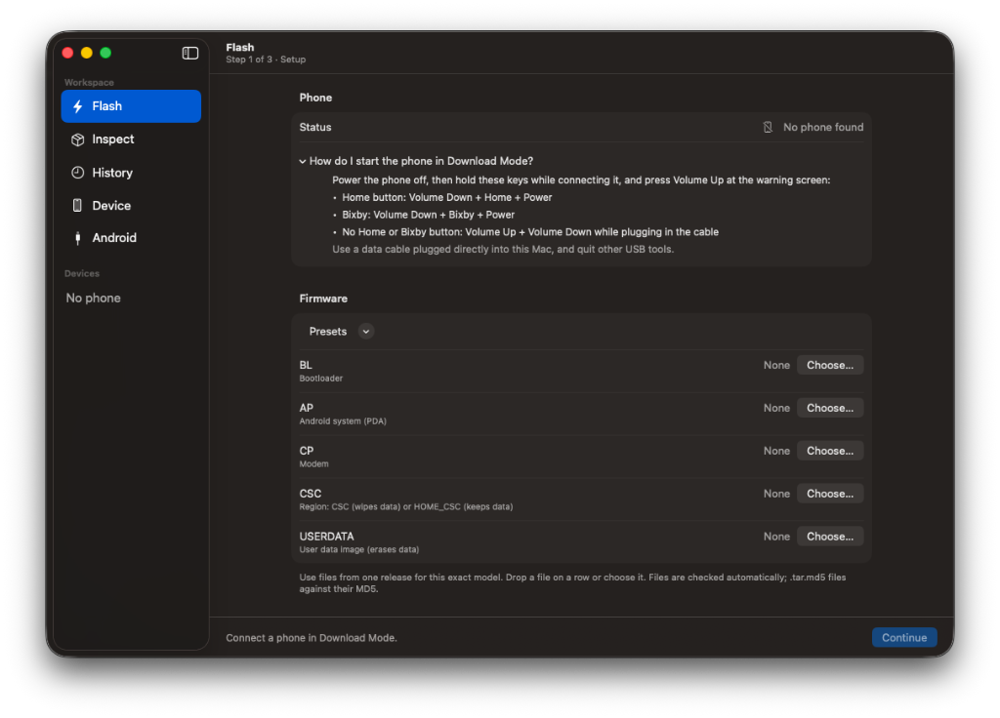
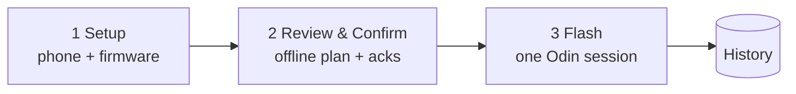

<p align="center">
  
</p>

<h1 align="center">Bifrost Studio</h1>

<p align="center"><strong>Samsung Galaxy firmware flasher for Mac — native Odin / Heimdall alternative for macOS (Download Mode, .tar.md5).</strong></p>

<p align="center">
  <a href="https://github.com/sritulasiram/bifrost-studio/releases/latest">Latest release</a>
  ·
  <a href="CHANGELOG.md">1.1.0</a>
</p>

Bifrost Studio flashes Samsung Galaxy firmware over USB in **Download Mode**, the way **Odin** does on Windows, but as a native macOS app (no Wine, no Java). It uses the same **`.tar.md5`** packages (BL, AP, CP, CSC, HOME_CSC) as Odin and common Heimdall workflows, with offline plan review before any bytes hit the phone.

> **Warning.** Flashing can leave a phone unbootable or erase its data. Use it only on a phone you are prepared to recover, with firmware for that exact model. Not affiliated with Samsung.

> **Beta.** Version **1.1.0** is tested on **SM-N915G**, **SM-N920I**, and **SM-N950F**; **SM-N986U1** is still blocked. Release builds are **ad-hoc signed** (not Apple-notarized yet). If something goes wrong, [open an issue](https://github.com/sritulasiram/bifrost-studio/issues) with the phone model, firmware build, and the log from **History › Export › Copy for Bug Report**.



## Features

- **Fail safe.** Images are verified and planned before any byte is sent; ambiguous mappings are refused. No re-partition, NAND erase-all, modem type 1, or hidden overrides.
- **Plan before you flash.** See which image goes to which partition offline, from the firmware's PIT or a saved PIT file.
- **Verified inputs.** MD5 check of every `.tar.md5`, and every LZ4 image decoded once before the phone is touched.
- **Explicit confirmation.** The model must match the firmware; full **CSC** or **USERDATA** slots require a separate data-erase acknowledgement (use **HOME_CSC** to keep data when appropriate).
- **Background flashing.** A flash keeps running if you quit the window; reconnect via **History** or the agent.
- **Honest failures.** Every error reports whether the phone received no data, partial data, or a complete write.
- **Extras.** Sidebar **Inspect**, **History**, **Device** (probe, PIT backup), **Android** (bundled `adb`/fastboot, TWRP prep), CLI, and searchable job history. Android helpers are UNVERIFIED on hardware.

## How it works



A flash must be the **first Odin session after the phone enters Download Mode**; the app does not resume a flash mid-session. Re-enter Download Mode after **Device** probe or PIT backup. Details: [architecture](docs/architecture.md) and [protocol](docs/protocol.md).

## Supported devices

| | |
|---|---|
| Tested on hardware | **SM-N920I (Galaxy Note 5):** full flash succeeded on 2026-11-08 (BL + AP + CP + full CSC, about 4.9 GB in about 2.5 minutes). |
| | **SM-N950F (Galaxy Note 8):** full flash succeeded on 2026-11-09 (about 6.6 GB in about 200 seconds). |
| | **SM-N915G (Galaxy Note Edge):** tested. |
| In testing | **SM-N986U1 (Galaxy Note 20 Ultra 5G):** handshake still failing — [hardware](docs/hardware.md). |
| Intended | Samsung phones that Odin can flash, including many unlisted Download Mode USB product IDs. **Untested** on most models. |
| Mac | macOS 13 or newer. Universal binary (Apple Silicon + Intel). |

Not supported, on purpose: modem-type (binary type 1) partitions, re-partitioning, NAND erase, and firmware downloading. Details: [hardware results](docs/hardware.md).

## Install

1. Download **`BifrostStudio-1.1.0.dmg`** from [GitHub Releases](https://github.com/sritulasiram/bifrost-studio/releases) (or build your own — below).
2. Open the DMG and drag **Bifrost Studio** to **Applications**.
3. On first launch, if macOS blocks the app: **right-click** the app → **Open**, or use **System Settings › Privacy & Security › Open Anyway** (ad-hoc signature).
4. Open **Settings** (⌘,) → **Services** → **Register**, then allow Bifrost Studio in **System Settings › General › Login Items** (background agent + root USB helper).
5. Put the phone in Download Mode, connect USB, and use **Flash** (drop firmware on the sidebar or each slot).

To uninstall: **Unregister** in Settings, then delete the app. History lives in `~/Library/Application Support/Bifrost Studio/History/`.

Maintainers building locally: `./packaging/install-local.sh ~/Library/Caches/BifrostBuild` copies a fresh build into `~/Applications`.

## Command line

```sh
CLI="$HOME/Applications/Bifrost Studio.app/Contents/MacOS/bifrost-cli"
"$CLI" agent devices
"$CLI" inspect AP_….tar.md5
bifrost-cli plan --pit device.pit --ap AP_….tar.md5 --csc HOME_CSC_….tar.md5
"$CLI" agent flash --bus 1 --address 4 --model SM-N920I --ap … --csc …
```

Direct USB commands need `sudo`. **`agent`** commands use the background service and do not. Recipes: [CLI reference](docs/cli.md#workflows).

## Build from source

You need macOS 13+, **CMake 3.26+** (`brew install cmake`), Xcode command-line tools, and a **universal libusb** under `LIBUSB_ROOT` (static `libusb-1.0.a` and/or dynamic `libusb-1.0.0.dylib` — see [build and install](docs/build-and-install.md)). The app bundle ships the dynamic library when present. LZ4 and Android platform-tools are fetched at configure time (network required once).

```sh
S=$HOME/Library/Caches/BifrostBuild
cmake -S . -B "$S" -DCMAKE_BUILD_TYPE=Release -DLIBUSB_ROOT=$HOME/.local
cmake --build "$S" -j"$(sysctl -n hw.ncpu)"
./scripts/check-l10n.sh
ctest --test-dir "$S" --output-on-failure
cmake --build "$S" --target dmg    # → $S/BifrostStudio-1.1.0.dmg
```

Keep build directories outside the repo. CI mirror: `./scripts/ci-local.sh`. Signing and notarization: [release](docs/release.md).

## Documentation

All pages live in [docs/](docs). Start with the [documentation map](docs/README.md), or use this index.

| I want to… | Read |
|---|---|
| Understand how the pieces fit and how a flash runs | [Architecture](docs/architecture.md) |
| Know the Odin protocol, planner rules and open questions | [Protocol and planner](docs/protocol.md) |
| See what the agent and USB helper do, and the security model | [Services](docs/services.md) |
| See how the SwiftUI app works (incl. macOS HIG) | [The app](docs/app.md) |
| Flash a phone, enter Download Mode, fix a failed flash | [Using Bifrost Studio](docs/using.md) |
| Build, install and register the services | [Build and install](docs/build-and-install.md) |
| Run tests, simulator, fuzzers, journal, CI | [Testing](docs/testing.md) |
| Look up a `bifrost-cli` command | [CLI reference](docs/cli.md) |
| Look up a C API function, struct or error code | [C API](docs/c-api.md) |
| Look up an XPC message between app, agent and helper | [Service wire protocol](docs/service-wire.md) |
| Status, coverage gaps, known issues | [Status](docs/status.md) |
| Phased roadmap (what shipped in 1.1.0) | [Roadmap](docs/roadmap.md) |
| Ship a signed / notarized DMG (+ trademark checklist) | [Release](docs/release.md) |
| Find a requirement ID such as F-40 or S-4 | [Requirements](docs/requirements.md) |
| See what has been observed on a real phone | [Hardware results](docs/hardware.md) |
| See what changed between versions | [Changelog](CHANGELOG.md) |

## Contributing

Contributions are welcome, especially hardware results from other models. Read [CONTRIBUTING.md](CONTRIBUTING.md) first: the safety rules are strict, and some changes (anything destructive, anything touching modem-type partitions) need the maintainer's approval of a design before code.

## Acknowledgements

The Odin protocol is undocumented. [Heimdall](https://github.com/Benjamin-Dobell/Heimdall), [Thor](https://github.com/Samsung-Loki/Thor) and Samsung's open-source odin4 were used as behavioural references only; no code was copied. [LZ4](https://github.com/lz4/lz4) and [libusb](https://github.com/libusb/libusb) are linked into the app. Not affiliated with any of them, or with Samsung.

## Licence

[MIT](LICENSE). LZ4 (BSD-2-Clause), libusb (LGPL-2.1) and the bundled Android platform-tools (Apache-2.0) keep their own licences; see [THIRD-PARTY-NOTICES.txt](THIRD-PARTY-NOTICES.txt). The release DMG includes **`Contents/Frameworks/libusb-1.0.0.dylib`**; you may replace it with a compatible build of the same soname (LGPL-2.1).