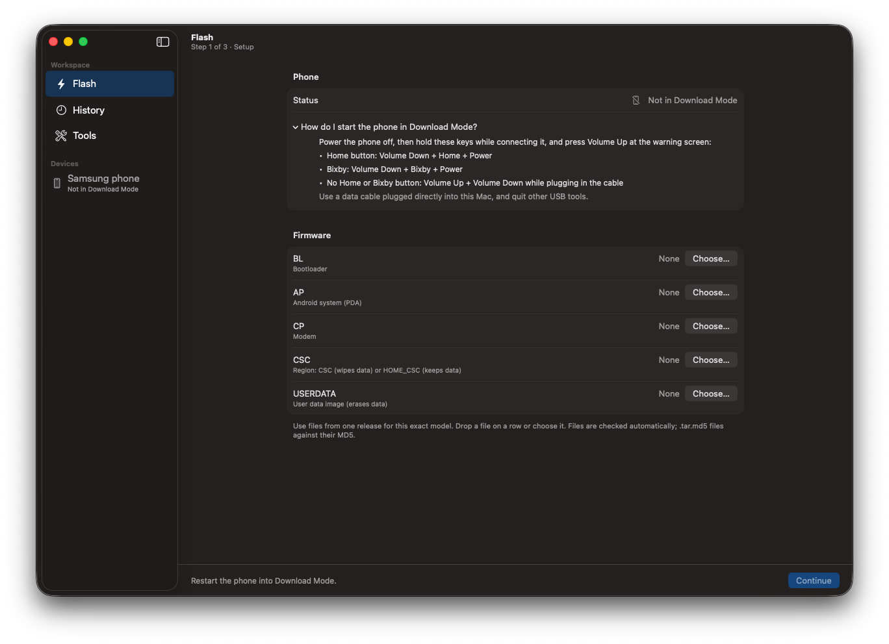
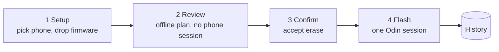

<p align="center">
  
</p>

<h1 align="center">Bifrost Studio</h1>

<p align="center"><strong>Samsung firmware flasher for Mac: a native Odin alternative for macOS.</strong></p>

Bifrost Studio flashes Samsung Galaxy firmware over USB in Download Mode, the way Odin does, but natively on macOS. It takes the same `.tar.md5` packages (BL, AP, CP, CSC), so you need no Windows, Wine, Java or Heimdall build.

> **Warning.** Flashing can leave a phone unbootable or erase its data. Use it only on a phone you are prepared to recover, with firmware for that exact model. Not affiliated with Samsung.

> **Beta.** Tested on three Samsung phones so far (SM-N915G, SM-N920I, SM-N950F), with the SM-N986U1 in testing, and the DMG is not yet notarized (see [Supported devices](#supported-devices)). If something goes wrong, [open an issue](https://github.com/sritulasiram/bifrost-studio/issues) with the phone model, the firmware build and the log from History > Export > Copy for Bug Report.



## Features

- **Fail safe.** Everything is checked before any data leaves the Mac, and anything ambiguous is refused. There is no way to re-partition, erase NAND or wipe user data.
- **Plan before you flash.** See which image goes to which partition, offline, from the firmware's PIT.
- **Verified inputs.** MD5 check of every `.tar.md5`, and every LZ4 image decoded once before the phone is touched.
- **Explicit confirmation.** The model is read from the firmware, and any data erase needs a separate acknowledgement.
- **Background flashing.** A flash keeps running if you close the window.
- **Honest failures.** Every error says whether the phone received no data, some or all of it.
- **Extras.** Probe, PIT backup, firmware inspector, searchable job history and a command-line tool. Unreleased and untested on hardware: reboot a phone to Download Mode with a bundled `adb`, and prepare a TWRP flash.

## How it works



A flash must be the **first Odin session after the phone enters Download Mode**; it never resumes. Restart into Download Mode after a probe or PIT backup. Details: [architecture](docs/architecture.md) and [protocol](docs/protocol.md).

## Supported devices

| | |
|---|---|
| Tested on hardware | **SM-N920I (Galaxy Note 5):** full flash succeeded on 2026-11-08 (BL + AP + CP + full CSC, about 4.9 GB in about 2.5 minutes). |
| | **SM-N950F (Galaxy Note 8):** full flash succeeded on 2026-11-09 (about 6.6 GB in about 200 seconds). |
| | **SM-N915G (Galaxy Note Edge):** tested. |
| In testing | **SM-N986U1 (Galaxy Note 20 Ultra 5G):** not working yet. |
| Intended | Samsung phones that Odin can flash, detected automatically. **Untested** on any other model. |
| Mac | macOS 13 or newer. Built and run on an Intel Mac only so far; the build is universal (arm64 + x86_64). |

Not supported, on purpose: modem-type (binary type 1) partitions, re-partitioning, NAND erase, and firmware downloading. Partitions the planner can't map unambiguously are refused. Details: [hardware results](docs/hardware.md).

## Install

A notarized release doesn't exist yet. With a DMG you built yourself:

1. Drag **Bifrost Studio** to **Applications**.
2. The build is signed ad hoc, so on first launch open **System Settings › Privacy & Security** and click **Open Anyway**.
3. In the app, open **Settings** (⌘,) and click **Register**, then approve Bifrost Studio in **System Settings › General › Login Items**. This installs a per-user background agent and a small root helper that only claims the Samsung USB interface.
4. Put the phone in Download Mode, connect it, and follow the three-step flow.

To uninstall, click **Unregister** in Settings and move the app to the Trash. Flash history is in `~/Library/Application Support/Bifrost Studio`.

## Command line

```sh
bifrost-cli devices                                   # find the phone (bus and address change on each re-plug)
bifrost-cli inspect AP_….tar.md5                      # list a package, check its MD5
bifrost-cli plan --pit device.pit --ap AP_….tar.md5 --csc CSC_….tar.md5   # offline plan, no device
bifrost-cli agent flash --bus 1 --address 4 --model SM-N920I --ap … --csc …
```

Direct USB commands need `sudo`. The `agent` commands go through the background service and don't. Full list: [CLI reference](docs/cli.md).

## Build from source

You need macOS 13+, CMake 3.26+, the Xcode command-line tools and a **universal static libusb 1.0.28 or newer** installed under a prefix you pass as `LIBUSB_ROOT` (for example `~/.local/lib/libusb-1.0.a`). LZ4 and the Android platform-tools are downloaded when you configure, so the first run needs network access.

```sh
cmake -S . -B ../bifrost-build -DCMAKE_BUILD_TYPE=Release -DLIBUSB_ROOT=$HOME/.local
cmake --build ../bifrost-build -j8
ctest --test-dir ../bifrost-build --output-on-failure
cmake --build ../bifrost-build --target dmg
```

Keep build directories outside the repository. More options, install steps and the fuzz build: [build and install](docs/build-and-install.md).

## Documentation

All pages are in [docs/](docs); this table is the index.

| I want to… | Read |
|---|---|
| Understand how the pieces fit and how a flash runs | [Architecture](docs/architecture.md) |
| Know the Odin protocol, planner rules and open questions | [Protocol and planner](docs/protocol.md) |
| See what the agent and USB helper do, and the security model | [Services](docs/services.md) |
| See how the SwiftUI app works | [The app](docs/app.md) |
| Flash a phone, enter Download Mode, fix a failed flash | [Using Bifrost Studio](docs/using.md) |
| Build, install and register the services | [Build and install](docs/build-and-install.md) |
| Run tests, the simulator or the fuzzers | [Testing](docs/testing.md) |
| Look up a `bifrost-cli` command | [CLI reference](docs/cli.md) |
| Look up a C API function, struct or error code | [C API](docs/c-api.md) |
| Look up an XPC message between app, agent and helper | [Service wire protocol](docs/service-wire.md) |
| Check current state, known issues and roadmap | [Status](docs/status.md) |
| Find a requirement ID such as F-40 or S-4 | [Requirements](docs/requirements.md) |
| See what has been observed on a real phone | [Hardware results](docs/hardware.md) |
| See what changed between versions | [Changelog](CHANGELOG.md) |

## Contributing

Contributions are welcome, especially hardware results from other models. Read [CONTRIBUTING.md](CONTRIBUTING.md) first: the safety rules are strict, and some changes (anything destructive, anything touching modem-type partitions) need the maintainer's approval of a design before code.

## Acknowledgements

The Odin protocol is undocumented. [Heimdall](https://github.com/Benjamin-Dobell/Heimdall), [Thor](https://github.com/Samsung-Loki/Thor) and Samsung's open-source odin4 were used as behavioural references only; no code was copied. [LZ4](https://github.com/lz4/lz4) and [libusb](https://github.com/libusb/libusb) are linked into the app. Not affiliated with any of them, or with Samsung.

## Licence

[MIT](LICENSE). LZ4 (BSD-2-Clause), libusb (LGPL-2.1) and the bundled Android platform-tools (Apache-2.0) keep their own licences; see [THIRD-PARTY-NOTICES.txt](THIRD-PARTY-NOTICES.txt). libusb is linked statically for now and must become a replaceable dynamic library before the DMG is shared (D-3).
