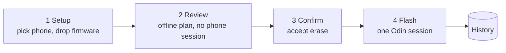

<p align="center">
  
</p>

<h1 align="center">Bifrost Studio</h1>

<p align="center"><strong>Samsung firmware flasher for Mac: a native Odin alternative for macOS.</strong></p>

Bifrost Studio is a native macOS app for flashing Samsung Galaxy firmware over USB in Download Mode. It takes the same `.tar.md5` packages (BL, AP, CP, CSC) as Odin, so you can flash stock firmware from a Mac with no Windows, no Wine, no Java and no Heimdall build. Built with SwiftUI.

> **Warning.** Flashing can leave a phone unbootable or erase its data. Use it only on a phone you are prepared to recover, with firmware for that exact model. Not affiliated with Samsung.

> **Beta.** Bifrost Studio is currently in its beta phase and has so far been tested on one Samsung phone. It will be tested on more Samsung devices over time. You are welcome to try it and tell me how it goes. If you run into any problem, please [open an issue](https://github.com/sritulasiram/bifrost-studio/issues) and include the phone model, the firmware build and the log from History (History > Export > Copy for Bug Report).

**Project status: beta.** One phone has been tested (see [Supported devices](#supported-devices)), and the DMG is not yet notarized.


## Why it's different: fail safe

Every step that could write the wrong thing is checked **before any data leaves the Mac**, and anything ambiguous is refused. The planner will not flash a package that doesn't match the phone, and it contains no way to re-partition, erase NAND or wipe user data on its own.

## Features

- **Plan before you flash.** Review exactly which image goes to which partition, offline, without opening a session on the phone. The plan comes from the PIT embedded in the firmware or from a PIT file.
- **Verified inputs.** MD5 check of every `.tar.md5`, TAR parsing with large-file support, and every LZ4 image decoded once before the phone is touched. A file that changes after verification is refused.
- **Refusal-first planner.** Wrong model, wrong slot, duplicate or shared partition targets, a PIT that differs from the phone's, and modem-type partitions are all refused.
- **Explicit confirmation.** The model is read from the firmware, and any data erase (full CSC, USERDATA) needs a separate acknowledgement.
- **Background flashing.** A flash keeps running if you close the window, and the app reattaches when you reopen it.
- **Honest failures.** Every error says whether the phone received no data, some data or all of it, and the app shows matching recovery advice.
- **Extras.** Probe, PIT backup, a firmware inspector, a job history you can search and export, and a command-line tool.

## How it works



A flash must be the **first Odin session after the phone enters Download Mode**; it never resumes. If you probe the phone or back up its PIT first, restart it into Download Mode before flashing. Details: [architecture](docs/design/architecture.md) and [protocol](docs/design/protocol.md).

## Supported devices

| | |
|---|---|
| Tested on hardware | **Samsung SM-N920I (Galaxy Note 5).** A full flash succeeded on 2026-11-08: BL + AP + CP + full CSC, about 4.9 GB in about 2.5 minutes. |
| Intended | Samsung phones that Odin can flash, detected automatically. **Untested** on any other model. |
| Mac | macOS 13 or newer. Built and run on an Intel Mac only so far; the build is universal (arm64 + x86_64). |

Not supported, on purpose: modem-type (binary type 1) partitions, re-partitioning, NAND erase, and firmware downloading. Partitions the planner can't map unambiguously are refused. See [hardware results](docs/project/hardware.md) and the [requirements](docs/project/requirements.md) for what is verified and what isn't.

## Install

A notarized release doesn't exist yet. With a DMG you built yourself:

1. Drag **Bifrost Studio** to **Applications**.
2. The build is signed ad hoc, so on first launch open **System Settings › Privacy & Security** and click **Open Anyway**.
3. In the app, open **Settings** (⌘,) and click **Register**, then approve Bifrost Studio in **System Settings › General › Login Items**. This installs a per-user background agent and a small root helper that only claims the Samsung USB interface.
4. Put the phone in Download Mode, connect it, and follow the three-step flow.

To uninstall, click **Unregister** in Settings and move the app to the Trash. Flash history is in `~/Library/Application Support/Bifrost Studio`.

## Command line

```sh
bifrost-cli devices                                   # find the phone (bus and address change on each re-plug)
bifrost-cli inspect AP_….tar.md5                      # list a package, check its MD5
bifrost-cli plan --pit device.pit --ap AP_….tar.md5 --csc CSC_….tar.md5   # offline plan, no device
bifrost-cli agent flash --bus 1 --address 4 --model SM-N920I --ap … --csc …
```

Direct USB commands need `sudo`. The `agent` commands go through the background service and don't. Full list: [CLI reference](docs/reference/cli.md).

## Build from source

You need macOS 13+, CMake 3.26+, the Xcode command-line tools and a **universal static libusb 1.0.28 or newer** installed under a prefix you pass as `LIBUSB_ROOT` (for example `~/.local/lib/libusb-1.0.a`). LZ4 is downloaded when you configure, so the first run needs network access.

```sh
cmake -S . -B ../bifrost-build -DCMAKE_BUILD_TYPE=Release -DLIBUSB_ROOT=$HOME/.local
cmake --build ../bifrost-build -j8
ctest --test-dir ../bifrost-build --output-on-failure
cmake --build ../bifrost-build --target dmg
```

Keep build directories outside the repository. More options, install steps and the fuzz build: [build and install](docs/guides/build-and-install.md).

## Repository layout

```
src/core      C++17 library + C API (libbifrost.dylib)
src/service   bifrost-agent (LaunchAgent) and bifrost-usbd (root USB helper)
src/cli       bifrost-cli
src/app       SwiftUI app and the .app bundle build
packaging     launchd plists, DMG script and the DMG read-me
tests         unit tests, bootloader simulator, fixtures, fuzzing
docs          documentation; start at docs/README.md
```

## Documentation

Everything is under [docs/](docs/README.md), grouped by purpose:

| Folder | Contents |
|---|---|
| [docs/design/](docs/design) | [Architecture](docs/design/architecture.md), [protocol and planner](docs/design/protocol.md), [services and security](docs/design/services.md), [the app](docs/design/app.md) |
| [docs/reference/](docs/reference) | [C API](docs/reference/c-api.md), [CLI](docs/reference/cli.md), [service wire protocol](docs/reference/service-wire.md) |
| [docs/guides/](docs/guides) | [Build and install](docs/guides/build-and-install.md), [testing](docs/guides/testing.md) |
| [docs/project/](docs/project) | [Status and roadmap](docs/project/status.md), [requirements](docs/project/requirements.md), [hardware results](docs/project/hardware.md) |

## Contributing

Contributions are welcome, especially hardware results from other models. Read [CONTRIBUTING.md](CONTRIBUTING.md) first: the safety rules are strict, and some changes (anything destructive, anything touching modem-type partitions) need the owner's approval of a design before code.

## Acknowledgements

Bifrost Studio builds on the work of others. The Odin protocol is undocumented, and these projects made it possible to understand it.

| Project | Used for |
|---|---|
| [Heimdall](https://github.com/Benjamin-Dobell/Heimdall) (Benjamin Dobell and contributors) | Reference for the PIT layout, control and file-transfer packet formats, Download Mode product IDs and the resume behaviour. Cited in source comments (`libpit`, `BridgeManager`, `ControlPacket`, `FileTransferPacket`). |
| [Thor](https://github.com/Samsung-Loki/Thor) (Samsung-Loki) | Reference for the Odin session flow and the names of bootloader status codes. |
| odin4 (Samsung's open-source Odin release) | Reference for protocol-version decoding and which archive entries are skipped. |
| [LZ4](https://github.com/lz4/lz4) (Yann Collet) | Decoding LZ4-compressed firmware images. Linked into the app. |
| [libusb](https://github.com/libusb/libusb) | USB access on macOS. Linked into the app. |

Heimdall, Thor and odin4 were used as behavioural references: we read them to learn what the bootloader expects and tested the result against a real phone. Bifrost Studio is not affiliated with any of them, or with Samsung.

## Licence

Bifrost Studio is released under the [MIT License](LICENSE).

Third-party components, which keep their own licences: LZ4 (BSD-2-Clause) and libusb (LGPL-2.1). Their notices are in [THIRD-PARTY-NOTICES.txt](THIRD-PARTY-NOTICES.txt) and are bundled in the app. libusb is currently linked statically; it must become a replaceable dynamic library before the DMG is shared (requirement D-3). No code was copied from odin4 (Apache-2.0) or Thor (MPL-2.0).
