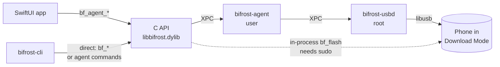
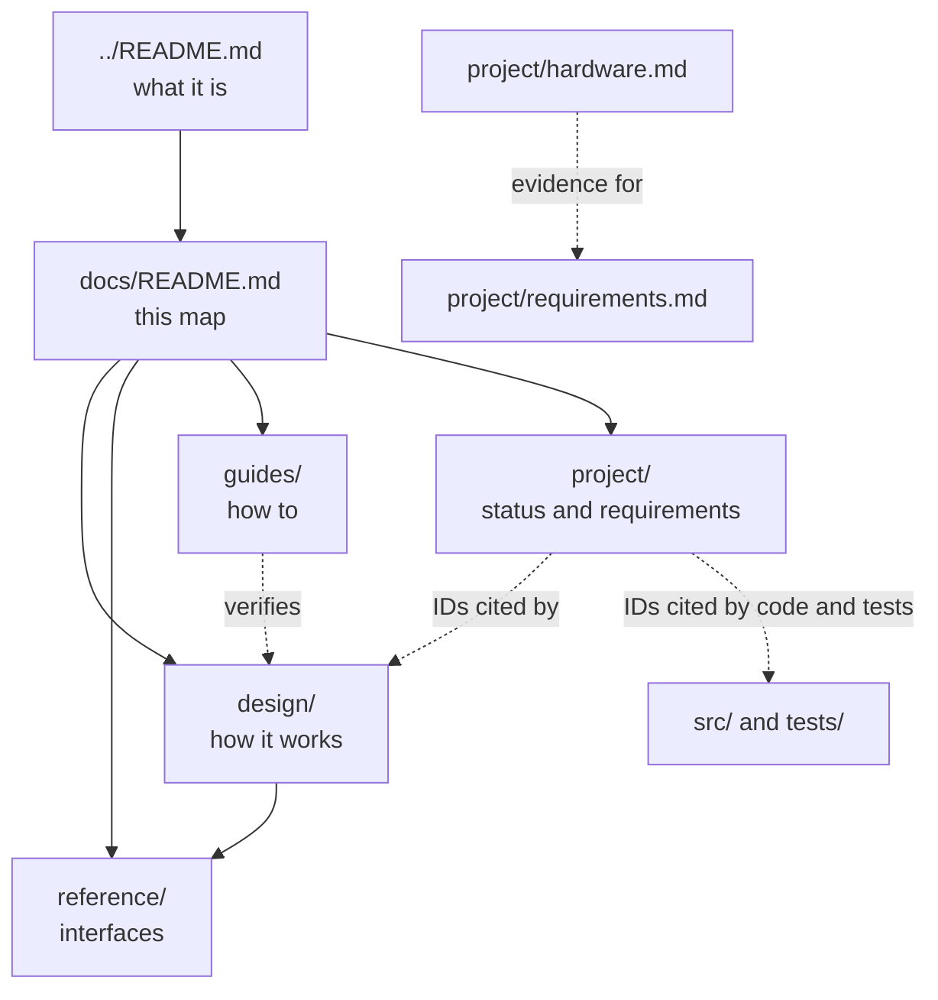

# Documentation

Start here. The docs are grouped by what you're trying to do. There is no single master file.

| Folder | Purpose | Pages |
|---|---|---|
| [design/](design/) | How it works | [architecture](design/architecture.md), [protocol](design/protocol.md), [services](design/services.md), [app](design/app.md) |
| [reference/](reference/) | Look-up documentation for interfaces | [c-api](reference/c-api.md), [cli](reference/cli.md), [service-wire](reference/service-wire.md) |
| [guides/](guides/) | How to do things | [build-and-install](guides/build-and-install.md), [testing](guides/testing.md) |
| [project/](project/) | Where the project stands | [status](project/status.md), [requirements](project/requirements.md), [hardware](project/hardware.md) |

## Which page answers what

| I want to know… | Read |
|---|---|
| What the product is | [../README.md](../README.md) |
| How the pieces fit, and how a flash runs | [design/architecture.md](design/architecture.md) |
| The Odin protocol, planner rules, open protocol questions | [design/protocol.md](design/protocol.md) |
| What the agent and USB helper do, and the security model | [design/services.md](design/services.md) |
| How the SwiftUI app works | [design/app.md](design/app.md) |
| A C API function, struct or error code | [reference/c-api.md](reference/c-api.md) |
| A `bifrost-cli` command or its output | [reference/cli.md](reference/cli.md) |
| An XPC message between app, agent and helper | [reference/service-wire.md](reference/service-wire.md) |
| How to build, install and register the services | [guides/build-and-install.md](guides/build-and-install.md) |
| How to run tests, use the simulator or fuzz | [guides/testing.md](guides/testing.md) |
| Current state, known issues, roadmap | [project/status.md](project/status.md) |
| A requirement ID such as F-40 or S-4 | [project/requirements.md](project/requirements.md) |
| What has been seen on a real phone | [project/hardware.md](project/hardware.md) |

## System at a glance

## How the docs relate

## Conventions

- **Fail safe.** Refuse on any ambiguity.
- **UNVERIFIED.** Never claim device behaviour works without a test or a source citation. Mark it UNVERIFIED until hardware settles it. Hardware results live only in [project/hardware.md](project/hardware.md). Statements in `design/` and `reference/` come from the code or tests.
- **Requirement IDs are stable.** Code comments and tests cite them, so don't renumber; see [project/requirements.md](project/requirements.md).
- **Diagrams are Mermaid.** GitHub and VS Code (with a Mermaid extension) render them.
- **Keep it current.** When behaviour or status changes, update the page that owns it: known issues in [project/status.md](project/status.md), requirement status in [project/requirements.md](project/requirements.md), hardware observations in [project/hardware.md](project/hardware.md), interfaces in `reference/`, mechanisms in `design/`.
- **Where new pages go.** Explains how something works: `design/`. Describes an interface to look things up in: `reference/`. A procedure to follow: `guides/`. Says where the project stands: `project/`.
