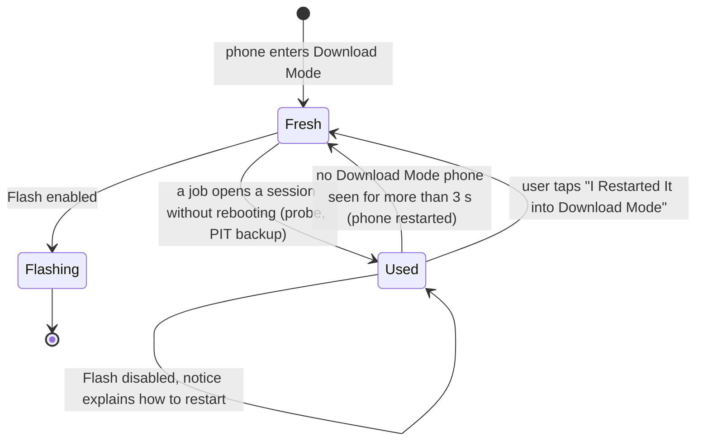

# The app

Bifrost Studio.app: macOS 13+, SwiftUI with `ObservableObject`. Device work goes through the agent (`bf_agent_*`, see [c-api.md](c-api.md)). Read-only work (package verification, PIT parsing, offline plans) runs in the app process. UX requirements are in [requirements.md](requirements.md#user-experience).

## Flash flow

1. **Setup.** Pick the phone; it is chosen automatically if only one is in Download Mode. Drop the firmware files. They are MD5-verified and parsed in the app process, with no phone access.
2. **Review.** The plan is built offline from the PIT inside the firmware (normally the CSC's, via `bf_packages_embedded_pit`) or from a PIT file the user opens. **No session is opened on the phone** (F-27).
3. **Confirm.** Acknowledge any data erase and choose whether to reboot. The app passes the firmware's detected model to the agent itself; the core still checks it. Erasing flashes ask for a final "Erase and Flash" confirmation.
4. **Flash.** The agent opens the files' descriptors, claims the phone through the root helper and runs `flash::flash` (see [architecture.md](architecture.md#a-flash-step-by-step)).

The flash must be the **first session since the phone entered Download Mode** (F-40). The app tracks this (`handshakeDone`) and blocks Flash until the phone has been restarted into Download Mode, for example after a probe or PIT backup.

## Source layout

Swift sources live under `src/app/Sources/` in four groups (single module; no sub-targets):

| Folder | Role |
|---|---|
| `App/` | `@main`, window chrome, settings, shared UI chrome, `L10n` |
| `Model/` | `AppModel` and extensions (history, inspect/tools) |
| `Bridge/` | C API types, agent client, launchd/SMAppService |
| `Workspace/` | Flash, Inspect, History, Device/Android workspaces and tool forms |

| File | Contents |
|---|---|
| `App/BifrostStudioApp.swift` | `@main`, Settings scene, terminal flags `--service-status`, `--register-services`, `--unregister-services` |
| `App/AppDelegate.swift` | Window presentation at launch |
| `App/Views.swift` | Sidebar (Workspace and Devices), service banner, `HandshakeToggle`, `JobLine`, `RecoveryCard`, `PlanView` |
| `App/SettingsView.swift` | General, Services, Flashing, Data, About, Diagnostics |
| `App/L10n.swift` | Keys for `Localizable.xcstrings` |
| `Model/AppModel.swift` | State, job tracking, review, `handshakeDone`, history retention, `Prefs` |
| `Model/AppModel+History.swift` | History load/save, export, retry |
| `Model/AppModel+Tools.swift` | Inspect packages, `toolsPitDiff`, session/plan export |
| `Bridge/Bridge.swift` | Value types from the C API, `LocalCore`, `PitTable` |
| `Bridge/AgentConnection.swift` | `bf_agent_*`; events on the main thread |
| `Bridge/BackgroundServices.swift` | `SMAppService` and service controls |
| `Workspace/WelcomeSheet.swift` | First-run workspace overview |
| `Workspace/FlashFlowView.swift` | Setup → Review & Confirm → Flash |
| `Workspace/ToolsInspectView.swift` | Inspect sidebar |
| `Workspace/HistoryView.swift` | Filter, search, export, retry |
| `Workspace/DeviceWorkspaceView.swift` | Device sidebar shell + session banner |
| `Workspace/DeviceToolViews.swift` | Probe and PIT backup forms |
| `Workspace/AndroidWorkspaceView.swift` | Android sidebar shell |
| `Workspace/AndroidToolViews.swift` | adb and TWRP forms |
| `Workspace/ToolsPlatform.swift` | Bundled adb/fastboot, TWRP tar validation |
| `Workspace/ToolsTypes.swift` | Shared enums for tool pages |
| `Workspace/DownloadModeGuide.swift`, `Workspace/PitDiffView.swift` | Flash copy and PIT diff UI |

- **`handshakeDone`:** set after any job that opened a session without rebooting the phone. Cleared when no Download Mode phone has been seen for more than 3 s, which means the phone was restarted. The user can override it ("I Restarted It into Download Mode").
- **History:** one JSON file per job in `~/Library/Application Support/Bifrost Studio/History/`.
- **`needsRestart`:** set when an attempt times out before any data was sent. Every attempt resets the phone's USB, so further attempts in the same Download Mode entry make it worse. Flash stays disabled until the phone has been restarted into Download Mode or the user clears the "already used" setting.

## Workspace sidebar

| Sidebar | Purpose |
|---------|---------|
| Flash | Setup → Review → Flash |
| Inspect | Offline packages, PIT, plan, `toolsPitDiff` |
| History | All agent jobs (flash, probe, PIT read) |
| Device | Probe and PIT backup (Download Mode; session banner) |
| Android | adb / fastboot and TWRP prep (UNVERIFIED on hardware) |

Menu shortcuts: **⌘1–5** for the five sections. Flash action still has no shortcut (F-33). Review's `pitDiff` stays on Flash › Review; Inspect and Device use `toolsPitDiff`.

- **Probe.** Opens a session without sending firmware or a PIT. **Copy Session Info** pastes ACK, protocol, and byte counts for support. Uses the Download Mode session; restart before flashing.
- **PIT Backup.** Saves the phone's partition table. On success, **Inspect** opens with that PIT when firmware is loaded in Flash or Inspect, and **toolsPitDiff** runs automatically. **Open in Inspect** and file compare work against Flash or Inspect-only packages.
- **Inspect.** Open `.tar.md5` / `.tar` without Flash Setup; MD5 verify and list entries; load PIT from file, Review, firmware CSC, or post-backup ingest; offline plan, copy/export plan text, pit summary.
- **Android.** Bundled platform-tools 37.0.1 (`adb`, `fastboot`): device picker when multiple phones are attached, reboot to Download Mode / Recovery / bootloader, restart adb. USB debugging and Mac authorisation required. UNVERIFIED on hardware.
- **TWRP.** Validates Odin-style `.img.tar`, shows a model hint from the filename, then **Prepare Flash** loads AP only and disables auto-reboot. Does not unlock the bootloader. UNVERIFIED on hardware.

## macOS design (HIG)

How the app should feel on the Mac. A copy ships in the app bundle as **Help → Design** (`Resources/Design.md`).

### Principles

1. **Safety before speed** — Ambiguous flashes are refused offline. Destructive flashes need explicit toggles and a confirmation alert. Flash has **no keyboard shortcut**.
2. **Honest state** — Download Mode vs not, session-used, service disconnected, and partial-write errors are plain language (`RecoveryCard`).
3. **Native shell** — `NavigationSplitView`, grouped settings (⌘,), system symbols, standard sheets/alerts.
4. **One job at a time** — Flash runs in the background agent; the window can close without stopping work.

### Layout

| Area | Pattern |
|------|---------|
| Sidebar | Workspace sections (`List(selection:)`) + read-only device list |
| Flash | Three-step wizard; bottom action bar for the primary action |
| History | Split list + detail |
| Device / Android | Single segmented sub-picker under the title when those sections are selected |
| Settings | Tabbed preferences scene |

### Accessibility and localization

- Sidebar and device rows expose selection to VoiceOver; progress views report percent; recovery cards are combined accessibility elements.
- `Resources/Localizable.xcstrings` for navigation and menus (UX-6); `en.lproj/Localizable.strings` stays in sync via `scripts/check-l10n.sh`.
- **Help → Bifrost Studio Help** opens `UserGuide.md` ([using.md](using.md)).
