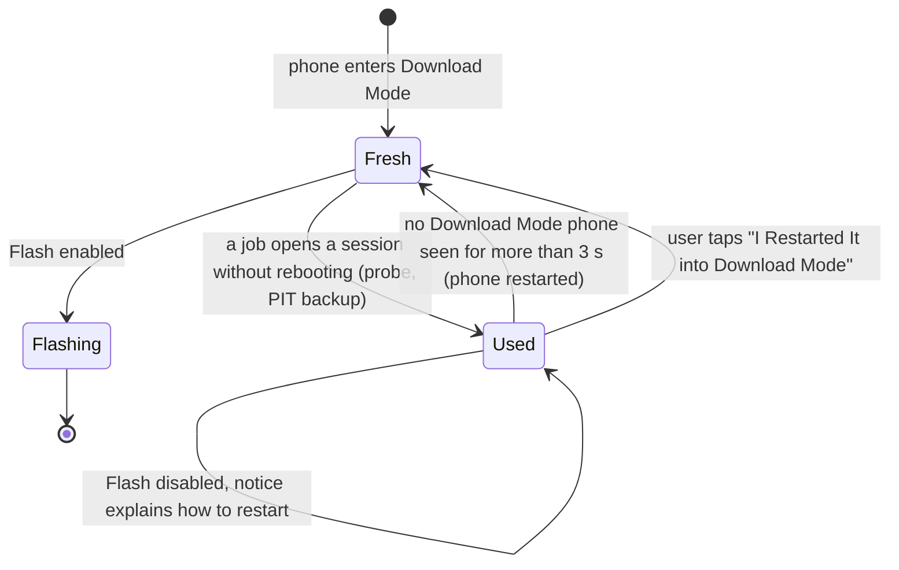

# The app

Bifrost Studio.app: macOS 13+, SwiftUI with `ObservableObject`. Device work goes through the agent (`bf_agent_*`, see [c-api.md](c-api.md)). Read-only work (package verification, PIT parsing, offline plans) runs in the app process. UX requirements are in [requirements.md](requirements.md#user-experience).

## Flash flow

1. **Setup.** Pick the phone; it is chosen automatically if only one is in Download Mode. Drop the firmware files. They are MD5-verified and parsed in the app process, with no phone access.
2. **Review.** The plan is built offline from the PIT inside the firmware (normally the CSC's, via `bf_packages_embedded_pit`) or from a PIT file the user opens. **No session is opened on the phone** (F-27).
3. **Confirm.** Acknowledge any data erase and choose whether to reboot. The app passes the firmware's detected model to the agent itself; the core still checks it. Erasing flashes ask for a final "Erase and Flash" confirmation.
4. **Flash.** The agent opens the files' descriptors, claims the phone through the root helper and runs `flash::flash` (see [architecture.md](architecture.md#a-flash-step-by-step)).

The flash must be the **first session since the phone entered Download Mode** (F-40). The app tracks this (`handshakeDone`) and blocks Flash until the phone has been restarted into Download Mode, for example after a probe or PIT backup.

## Source files

| File | Contents |
|---|---|
| `BifrostStudioApp.swift` | `@main`, Settings scene, ⌘1–3 shortcuts, terminal flags `--service-status`, `--register-services`, `--unregister-services` |
| `Bridge.swift` | Swift value types copied from the C API, `LocalCore` (in-process), `PitTable` (including the firmware's embedded PIT) |
| `AgentConnection.swift` | `bf_agent_*` wrapper; events are copied in the callback and delivered on the main thread |
| `AppModel.swift` | State, job tracking, review (firmware PIT or file), the `handshakeDone` heuristic, history and retention, `Prefs` |
| `FlashFlowView.swift` | ① Setup ② Review & Confirm ③ Flash, and the "restart into Download Mode" notice |
| `ToolsView.swift` | Probe, PIT Backup, Inspect, Android (bundled adb), TWRP |
| `HistoryView.swift` | Filter, search, summary, export, retry, delete |
| `SettingsView.swift` | General, Services, Flashing, Data, About, Diagnostics |
| `Views.swift` | Sidebar (Workspace and Devices), service banner, `HandshakeToggle`, `JobLine`, `RecoveryCard`, `PlanView` |
| `BackgroundServices.swift` | `SMAppService` helpers and service controls |

- **`handshakeDone`:** set after any job that opened a session without rebooting the phone. Cleared when no Download Mode phone has been seen for more than 3 s, which means the phone was restarted. The user can override it ("I Restarted It into Download Mode").
- **History:** one JSON file per job in `~/Library/Application Support/Bifrost Studio/History/`.
- **`needsRestart`:** set when an attempt times out before any data was sent. Every attempt resets the phone's USB, so further attempts in the same Download Mode entry make it worse. Flash stays disabled until the phone has been restarted into Download Mode or the user clears the "already used" setting.

## Tools

- **Probe, PIT Backup.** Each uses up the Download Mode session, so restart the phone before flashing.
- **Inspect.** Lists a package's entries and checks its MD5, with no phone.
- **Android.** Runs the `adb` from Android platform-tools 37.0.1 that ships inside the app (`Contents/Resources/platform-tools`): list phones, reboot to Download Mode or Recovery, restart the adb server. Rebooting to Download Mode needs USB debugging on and this Mac authorised on the phone. UNVERIFIED on hardware.
- **TWRP.** Loads a TWRP `.img.tar` as the only file in the AP slot and turns off the automatic restart, so the normal Flash flow can be used and you can boot straight into recovery. It does not unlock the bootloader. Unlocking erases all data and trips Knox permanently. UNVERIFIED on hardware.
