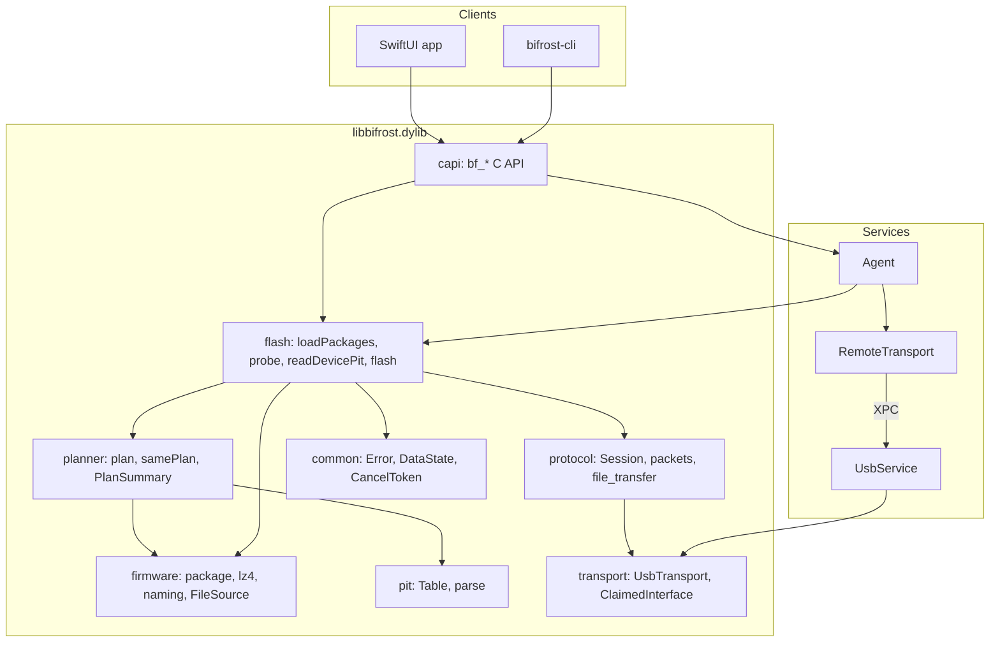
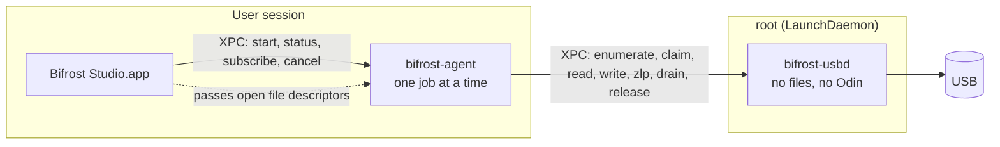
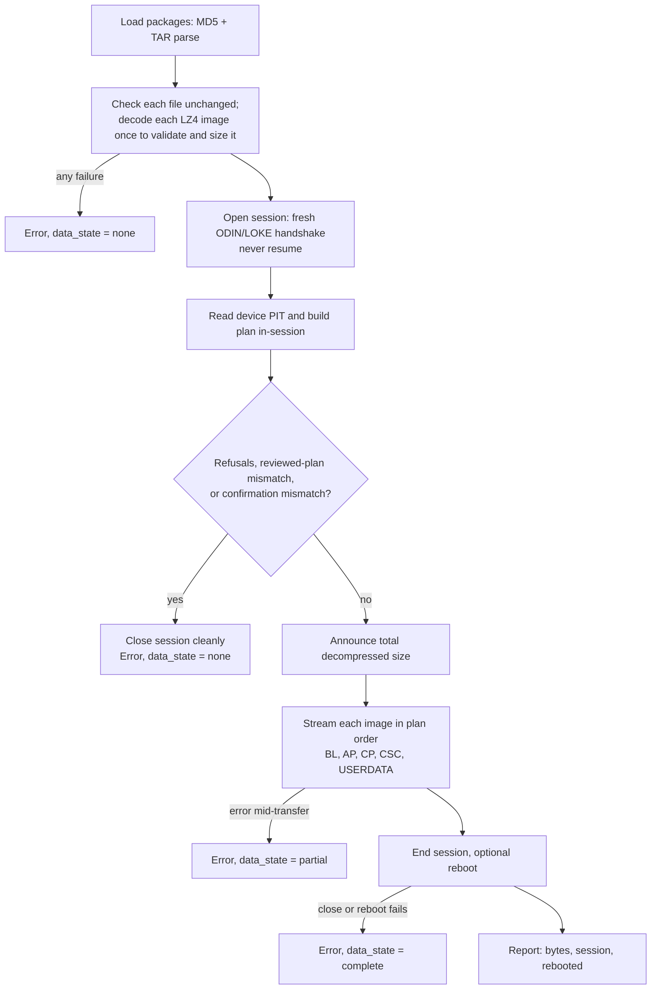
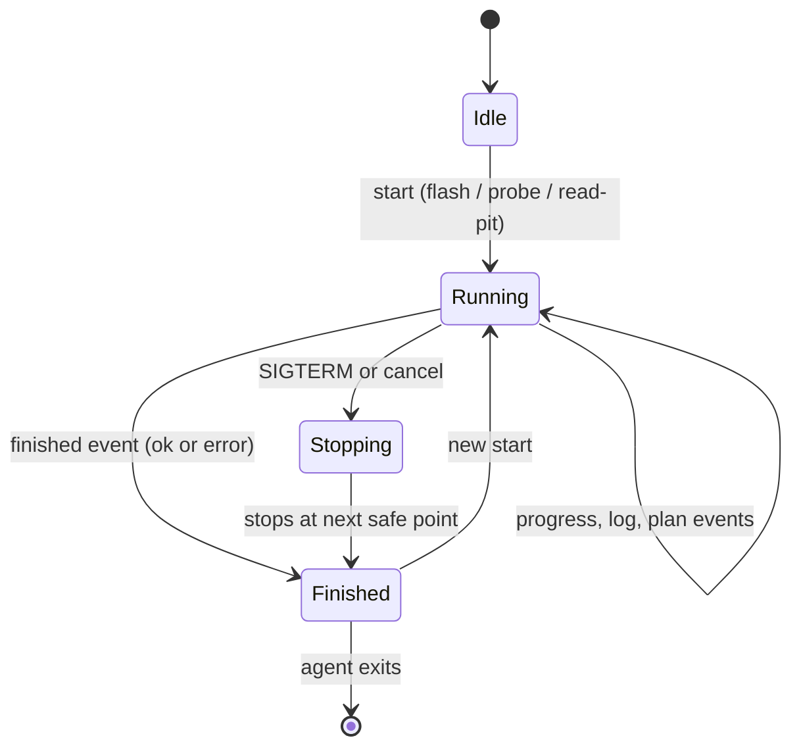
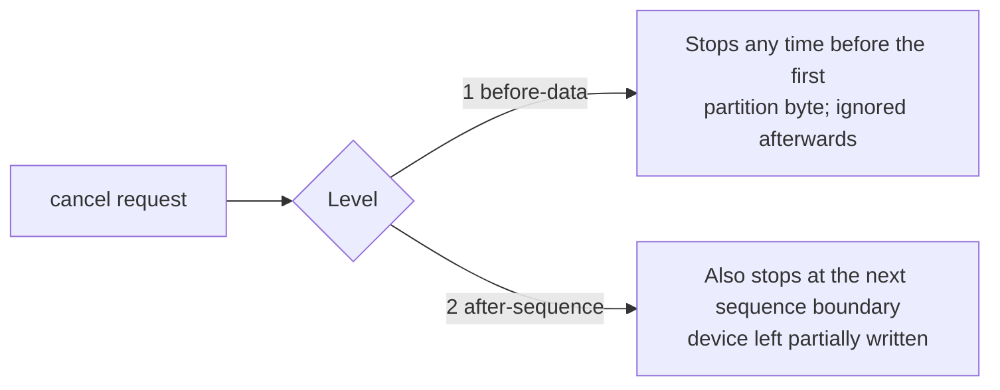

# Architecture

## Layers

Each layer depends only on those below it. Namespaces are `bifrost::…`; headers are under `src/core/include/bifrost/`.



| Module | Header | Responsibility |
|---|---|---|
| common | `common/error.hpp`, `cancel.hpp` | `ErrorCode`, `DataState {none, partial, complete}`, `Expected<T>` (C++17), `CancelToken` with levels `beforeData` / `afterSequence` |
| firmware | `firmware/package.hpp`, `lz4.hpp`, `naming.hpp`, `file_source.hpp` | MD5 trailer check, TAR parse, LZ4 frame decode, file-name heuristics, open-descriptor sources |
| pit | `pit/pit.hpp` | Parse and validate the partition information table |
| planner | `planner/plan.hpp` | `buildPlan`, `samePlan`, `checkConfirmation`, `PlanSummary`. Match package entries to PIT partitions; refusals, warnings, confirmations (rules in [protocol.md](protocol.md#planner-rules)) |
| protocol | `protocol/session.hpp`, `packet.hpp` | 1024-byte control packets; `Session` state machine `idle → open → closed \| failed`; file transfer in `src/protocol/file_transfer.cpp` ([protocol.md](protocol.md)) |
| transport | `transport/transport.hpp`, `libusb_transport.hpp`, `descriptors.hpp`, `iokit_registry.hpp` | `UsbTransport` (enumerate, claim, hot-plug) and `ClaimedInterface` (bulk read/write, ZLP, drain); libusb and remote implementations; Odin interface selection |
| flash | `flash/flash.hpp` | `loadPackages`, `probe`, `readDevicePit`, `flash` |
| capi | `bifrost/bifrost.h` | Stable C surface; only `bf_*` is exported |

## Process model



**Why two launchd jobs.** A flash is long and has state, so it can't live in a bundled XPC service, which macOS may stop when idle. The agent holds the job. The root helper exists only because detaching the macOS CDC driver from the phone's Odin interface needs root (hardware test T2a). Splitting them keeps root code minimal (SEC-1, SEC-2).

- The agent does everything that needs trust in firmware (verification, PIT, planning, the Odin session). The helper does only privileged USB I/O.
- The app passes firmware as **file descriptors**, so the agent needs no folder access and a path can't be swapped mid-flash.
- The agent keeps running if the app quits. A reconnecting client calls `status` to reattach and `subscribe` for live events.

## A flash, step by step

`flash::flash` in `src/core/src/flash/flash.cpp` (contract in `flash.hpp`):



Rules that shape this flow:

- A flash is the **first and only** Odin session after entering Download Mode ([requirements.md](requirements.md), F-40).
- The plan built inside the session must equal the offline plan the user reviewed (`samePlan`); otherwise the flash refuses before sending data.
- Every failure carries a `DataState`. Callers choose recovery guidance from `ErrorCode` + `DataState`, never from message text.

## Job lifecycle in the agent



- `start` while a job runs fails with `illegalState`.
- `status` returns the current or most recent job (log capped at `AgentOptions.logLimit`, default 500 lines).
- Progress events are throttled to `progressIntervalMs` (default 50 ms).

## Cancellation



A cancel persists until reset. In-process callers call `bf_cancel_reset` before each new operation, because a stale request makes the next operation stop before data (fail-safe).

## Errors

| Group | Codes |
|---|---|
| Input and files | `invalid-argument`, `io`, `package-invalid`, `checksum-mismatch`, `archive-unsupported`, `lz4-invalid`, `insufficient-space`, `file-changed` |
| Planning | `pit-invalid`, `plan-refused`, `model-mismatch` |
| USB and protocol | `usb-disconnected`, `usb-timeout`, `usb-stall`, `usb-access`, `usb-other`, `protocol-violation`, `bootloader-rejected` |
| Control | `cancelled`, `illegal-state`, `service-unavailable` |

`DataState` is orthogonal to the code: `none`, `partial` (some partition data may have been written) or `complete` (all data acknowledged; only close/reboot failed). Numeric values and names are in [c-api.md](c-api.md#errors).

## Source layout

```
CMakeLists.txt              top level: options, LZ4 fetch, subdirectories
README.md  CONTRIBUTING.md  THIRD-PARTY-NOTICES.txt
src/
  core/                     C++17 library
    include/bifrost/…       public headers (see the layer table above)
    include/module.modulemap  Swift module "Bifrost"
    src/…                   implementation; src/capi/ holds the C API and exports.txt
  service/                  agent and root helper
    include/bifrost/service/  wire.hpp, listener.hpp, usb_service.hpp,
                              remote_transport.hpp, agent.hpp, agent_client.hpp
    src/                    implementation; agent_main.cpp, usbd_main.cpp, service_config.hpp.in
  cli/src/                  main.cpp (direct commands), agent_commands.cpp (agent …)
  app/                      SwiftUI app and the bundle build (CMakeLists.txt)
    Sources/                see docs/app.md
    Resources/              create_app_icon.swift, icon/*.svg
    Info.plist.in
packaging/
  launchd/                  agent.plist.in, usbd.plist.in (SMAppService plists)
  make-dmg.sh               "Read Me First.txt"
tests/
  test_*.cpp                one suite per layer + C API + services
  support/                  test_support.hpp, sim_device.* (bootloader simulator)
  fixtures/                 SM-N920I.pit (real device PIT)
  fuzz/                     fuzz targets, standalone driver, corpus/
docs/                       documentation (index in README.md)
.github/workflows/ci.yml
```
