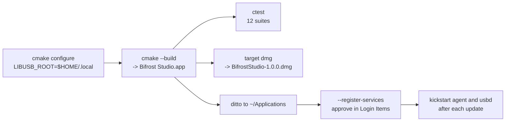

# Building and installing

For tests, the simulator and fuzzing, see [testing.md](testing.md).



## Build

You need macOS 13+, CMake 3.26+ and the Xcode command-line tools. If `cmake` is not on your `PATH` (for example a pip-installed copy), call it by full path. The build must be universal (or x86_64); never arm64-only.

```sh
S=$HOME/Library/Caches/BifrostBuild          # keep the build directory outside the repo
cmake -S . -B $S -DCMAKE_BUILD_TYPE=Release -DLIBUSB_ROOT=$HOME/.local
cmake --build $S -j8                          # → "$S/Bifrost Studio.app"
ctest --test-dir $S --output-on-failure
cmake --build $S --target dmg                 # → $S/BifrostStudio-1.0.0.dmg
```

## Dependencies
- **libusb:** universal static `~/.local/lib/libusb-1.0.a` (1.0.29; at least 1.0.28 is required).
- **LZ4:** v1.10.0, fetched at configure time and pinned by commit, so the first configure needs network access.
- **Android platform-tools:** r37.0.1 (`adb`), downloaded at configure time with a pinned SHA-256 and copied into the app's Resources. Needs network access on first configure.
- **Security framework:** must stay linked, because static libusb uses `SecTask*`.

## Options
- `-DBIFROST_BUILD_APP=OFF`: core and tests only.
- `-DBIFROST_ENABLE_USB=OFF`: no libusb.
- `-DBIFROST_TEAM_ID=…`: team-based peer checks.
- `-DBIFROST_FUZZ=ON`: sanitizers and fuzz targets; use a single architecture.

## Installing for use

```sh
APP=~/Applications/"Bifrost Studio.app"
rm -rf "$APP" && ditto "$S/Bifrost Studio.app" "$APP"
"$APP/Contents/MacOS/BifrostStudio" --register-services    # first time; approve in Login Items
launchctl kickstart -k gui/$(id -u)/local.bifrost.agent      # after updating the app
sudo launchctl kickstart -k system/local.bifrost.usbd        # after updating the app
"$APP/Contents/MacOS/BifrostStudio" --service-status
"$APP/Contents/MacOS/bifrost-cli" agent devices
```
