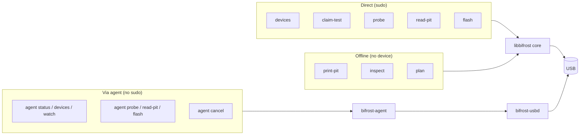
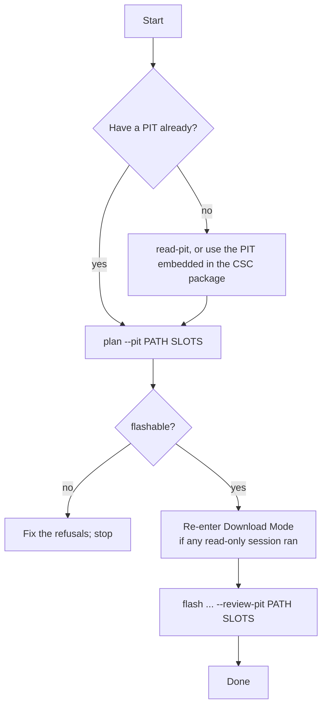

# Command-line tool

`bifrost-cli` (`src/cli/src/main.cpp`, `agent_commands.cpp`). It has two families of commands:

- **Direct** commands call the in-process C++ core and open USB themselves. They need `sudo`, because detaching the CDC driver needs root.
- **`agent`** commands talk to the running `bifrost-agent` over XPC, with no `sudo` (the agent uses the root helper).



## Commands

```
bifrost-cli devices [--machine]
bifrost-cli claim-test --bus N --address N
bifrost-cli probe    --bus N --address N [--resume]
bifrost-cli read-pit --bus N --address N --output PATH [--resume]
bifrost-cli print-pit PATH
bifrost-cli inspect PACKAGE
bifrost-cli plan --pit PATH SLOTS
bifrost-cli flash --bus N --address N --product-id N --model MODEL
                  [--accept-data-erase] [--no-reboot] [--review-pit PATH] [--machine] SLOTS

bifrost-cli agent status | devices | watch
bifrost-cli agent probe    --bus N --address N [--resume]
bifrost-cli agent read-pit --bus N --address N --output PATH [--resume]
bifrost-cli agent flash    --bus N --address N --model MODEL [--accept-data-erase]
                           [--no-reboot] [--review-pit PATH] SLOTS
bifrost-cli agent cancel --level before-data|after-sequence

SLOTS: --bl PATH --ap PATH --cp PATH --csc PATH --userdata PATH
```

| Command | Device? | Purpose |
|---|---|---|
| `devices` | enumerate | List Samsung devices with bus, address, product ID and Odin interface |
| `claim-test` | claim | Claim and release the interface; a driver-detach check |
| `probe` | session | Handshake, begin, end; prints session info |
| `read-pit` | session | Save the device PIT to a file |
| `print-pit`, `inspect` | no | Show a PIT file, or a package's entries and checksum |
| `plan` | no | Build and print a plan against a saved PIT (the offline review step) |
| `flash` | session | Flash. First session after entering Download Mode |
| `agent …` | via agent | Same actions through the background services |

## Which command, when



## Rules and behaviour

- `flash --resume` is refused. A flash must be the first Odin session after the phone enters Download Mode; re-enter Download Mode after `probe` or `read-pit`.
- USB addresses change on every re-enumeration. Run `devices` right before any device command and use the numbers it prints.
- `flash` needs `--model` (the typed model must match), and `--accept-data-erase` when the plan erases user data.
- `--review-pit PATH` makes the flash compare its in-session plan with the plan built offline from that PIT, and refuse if they differ.
- Ctrl-C on an `agent` command only detaches the CLI. The job keeps running; reattach with `agent status` or `agent watch`, and stop it with `agent cancel`.
- `agent cancel --level after-sequence` can leave the phone partially written; use it only when the user accepts that.

## Machine output

`--machine` (on `devices` and `flash`) prints tab-separated progress lines:

```
PROGRESS<TAB><phase><TAB><slot><TAB><entry><TAB><fileDone><TAB><fileTotal><TAB><totalDone><TAB><total>
```

| Field | Meaning |
|---|---|
| `phase` | `verifying`, `checking-images`, `connecting`, `reading-pit`, `planning`, `transferring`, `committing`, `closing`, `done` (from `flash::toString(Phase)` in `flash.cpp`) |
| `slot`, `entry` | Empty when not applicable |
| `fileDone/fileTotal` | Bytes of the current file |
| `totalDone/total` | Bytes of the whole flash |

A progress bar is `totalDone / total` while the phase is `transferring` or `committing`; otherwise show the phase name.

## Exit status

| Code | Constant | Meaning |
|---|---|---|
| 0 | `kExitOk` | Success; for `plan`, the plan is flashable |
| 1 | `kExitFailure` | The command failed; for `plan`, the plan is not flashable |
| 2 | `kExitUsage` | Bad or missing arguments, or an unknown command |

Defined in `src/cli/src/main.cpp`; no other exit values are returned.
