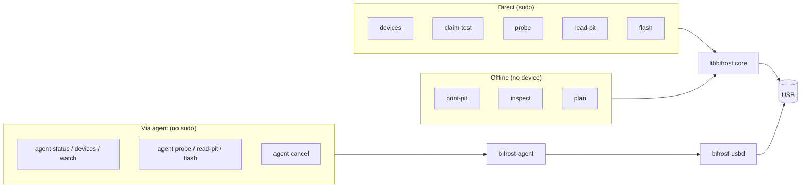
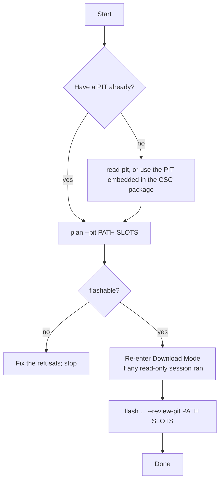

# Command-line tool

`bifrost-cli` (`src/cli/src/main.cpp`, `agent_commands.cpp`). It has two families of commands:

- **Direct** commands call the in-process C++ core and open USB themselves. They need `sudo`, because detaching the CDC driver needs root.
- **`agent`** commands talk to the running `bifrost-agent` over XPC, with no `sudo` (the agent uses the root helper).



## Commands

```
bifrost-cli devices [--machine]
bifrost-cli claim-test --bus N --address N
bifrost-cli probe    --bus N --address N [--resume]
bifrost-cli read-pit --bus N --address N --output PATH [--resume]
bifrost-cli print-pit PATH
bifrost-cli inspect PACKAGE
bifrost-cli plan --pit PATH SLOTS
bifrost-cli flash --bus N --address N --product-id N --model MODEL
                  [--accept-data-erase] [--no-reboot] [--review-pit PATH] [--machine] SLOTS

bifrost-cli agent status | devices | watch
bifrost-cli agent probe    --bus N --address N [--resume]
bifrost-cli agent read-pit --bus N --address N --output PATH [--resume]
bifrost-cli agent flash    --bus N --address N --model MODEL [--accept-data-erase]
                           [--no-reboot] [--review-pit PATH] SLOTS
bifrost-cli agent cancel --level before-data|after-sequence

SLOTS: --bl PATH --ap PATH --cp PATH --csc PATH --userdata PATH
```

| Command | Device? | Purpose |
|---|---|---|
| `devices` | enumerate | List Samsung devices with bus, address, product ID and Odin interface |
| `claim-test` | claim | Claim and release the interface; a driver-detach check |
| `probe` | session | Handshake, begin, end; prints session info |
| `read-pit` | session | Save the device PIT to a file |
| `print-pit`, `inspect` | no | Show a PIT file, or a package's entries and checksum |
| `plan` | no | Build and print a plan against a saved PIT (the offline review step) |
| `flash` | session | Flash. First session after entering Download Mode |
| `agent …` | via agent | Same actions through the background services |

## Which command, when



## Rules and behaviour

- `flash --resume` is refused. A flash must be the first Odin session after the phone enters Download Mode; re-enter Download Mode after `probe` or `read-pit`.
- USB addresses change on every re-enumeration. Run `devices` right before any device command and use the numbers it prints.
- `flash` needs `--model` (the typed model must match), and `--accept-data-erase` when the plan erases user data.
- `--review-pit PATH` makes the flash compare its in-session plan with the plan built offline from that PIT, and refuse if they differ.
- Ctrl-C on an `agent` command only detaches the CLI. The job keeps running; reattach with `agent status` or `agent watch`, and stop it with `agent cancel`.
- `agent cancel --level after-sequence` can leave the phone partially written; use it only when the user accepts that.

## Machine output

`--machine` (on `devices` and `flash`) prints tab-separated progress lines:

```
PROGRESS<TAB><phase><TAB><slot><TAB><entry><TAB><fileDone><TAB><fileTotal><TAB><totalDone><TAB><total>
```

| Field | Meaning |
|---|---|
| `phase` | `verifying`, `checking-images`, `connecting`, `reading-pit`, `planning`, `transferring`, `committing`, `closing`, `done` (from `flash::toString(Phase)` in `flash.cpp`) |
| `slot`, `entry` | Empty when not applicable |
| `fileDone/fileTotal` | Bytes of the current file |
| `totalDone/total` | Bytes of the whole flash |

A progress bar is `totalDone / total` while the phase is `transferring` or `committing`; otherwise show the phase name.

## Exit status

| Code | Constant | Meaning |
|---|---|---|
| 0 | `kExitOk` | Success; for `plan`, the plan is flashable |
| 1 | `kExitFailure` | The command failed; for `plan`, the plan is not flashable |
| 2 | `kExitUsage` | Bad or missing arguments, or an unknown command |

Defined in `src/cli/src/main.cpp`; no other exit values are returned.

## Workflows

These recipes mirror the app’s safety rules. Prefer **`bifrost-cli agent …`** when Bifrost Studio (or its agent) is installed — no `sudo` and the same entitlement path as the GUI.

### Everyday flash (agent, app services running)

```sh
CLI="$HOME/Applications/Bifrost Studio.app/Contents/MacOS/bifrost-cli"
# USB bus/address change after every cable plug or mode switch:
"$CLI" agent devices
"$CLI" agent flash --bus 1 --address 3 --model SM-N950F \
  --bl ~/firmware/BL_….tar.md5 \
  --ap ~/firmware/AP_….tar.md5 \
  --cp ~/firmware/CP_….tar.md5 \
  --csc ~/firmware/HOME_CSC_….tar.md5
```

Add flags when the offline plan demands it:

- `--accept-data-erase` — full `CSC_` or `USERDATA_` images (same as the app’s erase toggle).
- `--accept-bootloader-downgrade` — plan includes a bootloader downgrade warning.
- `--no-reboot` — leave the phone in Download Mode after a successful write.
- `--review-pit ~/backup/device.pit` — refuse unless the in-session plan matches one built offline from that PIT.

Watch or reattach to a long job after Ctrl-C detached the terminal:

```sh
"$CLI" agent watch
"$CLI" agent status
"$CLI" agent cancel --level before-data   # safe before any image bytes
```

### Offline review before touching USB

```sh
bifrost-cli inspect ~/firmware/HOME_CSC_….tar.md5
bifrost-cli plan --pit ~/device.pit \
  --bl ~/firmware/BL_….tar.md5 \
  --ap ~/firmware/AP_….tar.md5 \
  --cp ~/firmware/CP_….tar.md5 \
  --csc ~/firmware/HOME_CSC_….tar.md5
```

Exit code **0** means the plan is flashable; **1** means refusals or warnings blocked it (read the printed refusals). Save the PIT path for `--review-pit` on flash.

### Probe or PIT backup (then re-enter Download Mode)

```sh
bifrost-cli agent probe --bus 1 --address 3
bifrost-cli agent read-pit --bus 1 --address 3 --output ~/Desktop/device-$(date +%Y%m%d).pit
```

The bootloader answers the LOKE handshake once per Download Mode entry. After probe or read-pit, **power-cycle into Download Mode again** before `agent flash` (the app shows the same “fresh session” notice).

### Direct `sudo` flash (no agent)

For debugging core/USB code without services:

```sh
sudo bifrost-cli devices
sudo bifrost-cli flash --bus 1 --address 3 --product-id 0x685D --model SM-N950F \
  --accept-data-erase --review-pit ~/device.pit \
  --bl … --ap … --cp … --csc …
```

`flash` **rejects `--resume`**. Use `--resume` only on `probe` and `read-pit` when continuing after a prior session on the same Download Mode entry.

### Automation with `--machine`

Pipe progress into your own UI or CI logs:

```sh
"$CLI" agent flash --bus 1 --address 3 --model SM-N950F --machine \
  --ap ~/firmware/AP_….tar.md5 2>/dev/null | while IFS=$'\t' read -r tag phase _; do
  [ "$tag" = PROGRESS ] && echo "$phase"
done
```

### Troubleshooting

| Symptom | What to check |
|--------|----------------|
| `agent` cannot connect | `agent status`; register services from the app (Settings) or launchctl load the bundled plists |
| `illegalState` / handshake errors | Re-enter Download Mode; do not use `--resume` on flash |
| `planRefused` at flash time | Device PIT differs from review — run `read-pit` again or re-run `plan` with the embedded CSC PIT |
| Wrong device | Always run `devices` or `agent devices` immediately before the job |

See also [using.md](using.md) (GUI) and [services.md](services.md) (agent + USB helper).
