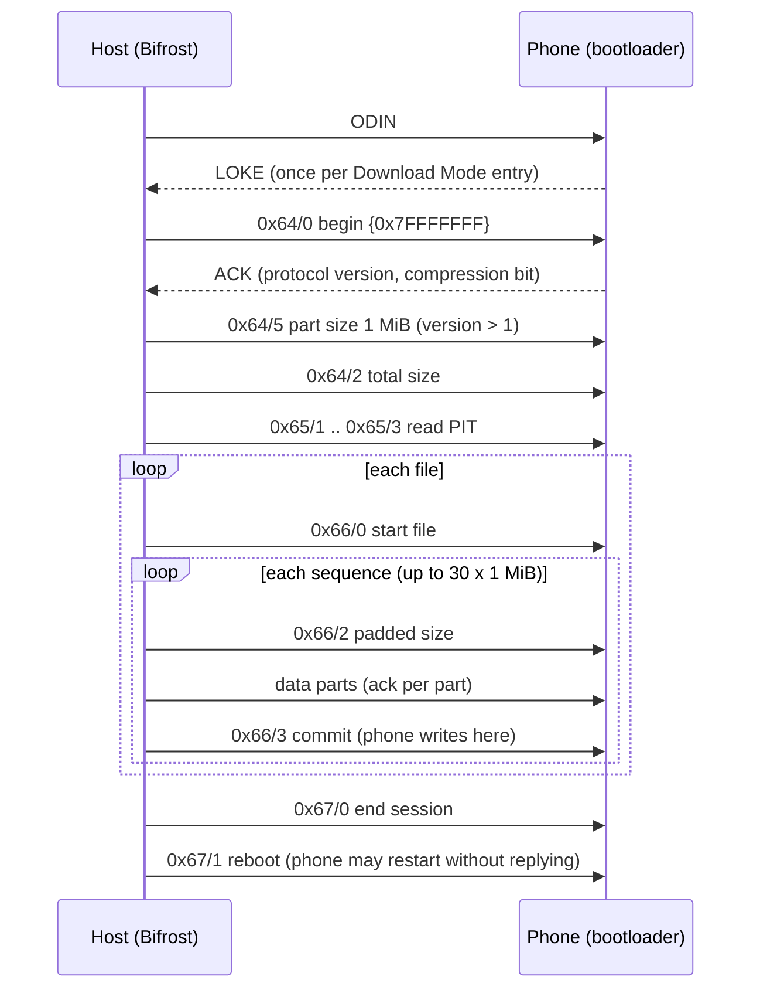

# Odin protocol and planner

How Bifrost Studio talks to the bootloader and decides what to write. Code: `src/core/src/protocol/` (session, packets, file transfer) and `src/core/src/planner/plan.cpp`. Requirement IDs (F-, S-, R-) are in [../project/requirements.md](../project/requirements.md). Device behaviour here is established by the SM-N920I run in [../project/hardware.md](../project/hardware.md); everything else is UNVERIFIED.

## Session at a glance



## Odin protocol as implemented

All control requests are **1024-byte packets**, `[command u32le][request u32le][arguments…]`, zero-filled. Each control packet is followed by a **zero-length packet (ZLP)**, best-effort. Every reply is 8 bytes, `[id u32le][value u32le]`. `0xFFFFFFFF` means `BOOTLOADER_FAIL`, and any negative value is a failure (S-6).

### Session

| Step | Sent | Reply |
|---|---|---|
| Handshake | `ODIN` (4 bytes) | `LOKE`. Answered **once per Download Mode entry**. |
| Begin | `0x64/0 {0x7FFFFFFF}` | `0x64`, value = ACK. Protocol version = `(ACK >> 16) & 0x7FFF`; bit 15 = compressed transfer supported |
| Part size (version > 1) | `0x64/5 {1048576}` | `0x64`, non-negative |
| Total size | `0x64/2 {low32, high32}` | `0x64`, non-negative |
| End session | `0x67/0` | `0x67` |
| Reboot | `0x67/1` | `0x67`. **The SM-N920I restarts without replying**; disconnecting right after this request counts as success (F-44). |

Part sizing: protocol version > 1 uses **1 MiB parts × 30 per sequence**; otherwise **128 KiB × 240**.

`resume` (probe and PIT read only) skips the handshake, for a later session in the same Download Mode entry. **A flash never resumes.**

### PIT read

`0x65/1` returns the PIT size (at most 1 MiB). Then `0x65/2 {index}` for each 500-byte part, a best-effort 1-byte IN drain, and `0x65/3`.

### Never sent

`0x64/1` (S-4). Compressed transfer (`0x66/5–7`) is not used; the Mac decompresses LZ4.

### File transfer (`src/core/src/protocol/file_transfer.cpp`)

```
0x66/0                                    start file
for each sequence (≤ 30 × 1 MiB):
  0x66/2 {paddedSize}                     paddedSize = parts × partSize
  for each part:  partSize bytes (zero-filled tail)  →  ack {0x00, partIndex}
  ZLP
  0x66/3 {0, realSize, binaryType, deviceType, partitionId, eof}
                                          →  ack {0x66, status}  (the phone writes the sequence here)
```

- No ZLP between data parts, and no IN drain after the commit acknowledgement.
- Modem-type targets (binary type 1) are refused before anything is sent (S-5).
- Progress is reported per acknowledged part. A "committing" phase is reported before each commit wait.
- A failure names its stage, for example `[while waiting for the acknowledgement of part 3 of 30; sequence 5 of 115; … bytes of this file acknowledged]`.

### Timeouts (R-1)

Handshake 3 s · control 10 s · data part 120 s · sequence commit 120 s · ZLP 100 ms.

## Planner rules

Implemented in `src/core/src/planner/plan.cpp`.

- **Matching:** a PIT `flashFilename` must equal the entry name, or the entry name minus `.lz4`. Matching is exact and case-sensitive.
- **Skipped, with a reason:** `meta-data/*` and root-level `*.pit`. Any other entry that doesn't map is refused.
- **Always refused:** modem-type targets; targets whose identifier is shared with another partition (identifiers repeat across UFS logical units, and the transfer addresses partitions by identifier only); duplicate partitions; ambiguous matches; empty images; a package in the wrong slot by its file name; packages for different models.
- **Embedded PIT:** any layout or size difference between the firmware's PIT and the phone's PIT is refused.
- **Needs acknowledgement:** full CSC, the USERDATA slot, or a userdata/data partition.
- **Order:** BL, AP, CP, CSC, USERDATA.
- **`samePlan`** compares, per file in order: slot, package, entry name, and the partition's identifier, binary type and device type.

## Open protocol questions

| Question | Current choice |
|---|---|
| End-of-sequence layout for modem-type partitions (binary type 1): references disagree on where the end-of-file flag goes | Refused (S-5). The SM-N920I has no such partitions. |
| Meaning of `0x64/1` | Never sent (S-4) |
| Rounding the real size to 512 bytes for SYSTEM/USERDATA/SUPER, as one reference does | Not done; relevant to newer phones (`super`) |
| Version decode and part sizing on older phones (protocol ≤ 1) | 128 KiB × 240; untested |
| Whether other phones need the same ZLP pattern and single-session rule | Assumed; untested |
| Compressed LZ4 transfer (`0x66/5–7`) | Not used |
| End the session after a pre-data rejection of `0x64/2` or the first `0x66/0` | Not done (the owner hasn't decided). The phone must be restarted into Download Mode. |
