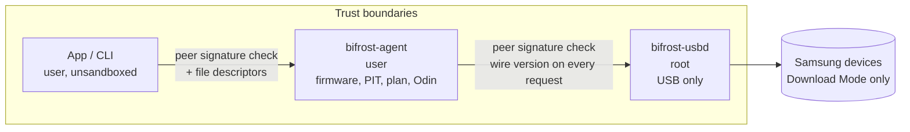

# Background services and security

`bifrost-agent` (per-user LaunchAgent) and `bifrost-usbd` (root LaunchDaemon). The message format is in [../reference/service-wire.md](../reference/service-wire.md); the process picture is in [architecture.md](architecture.md#process-model). Requirement IDs (SEC-, R-) are in [../project/requirements.md](../project/requirements.md).

| | bifrost-agent | bifrost-usbd |
|---|---|---|
| launchd | LaunchAgent `local.bifrost.agent`, `ExitTimeOut` 300 s | LaunchDaemon `local.bifrost.usbd` |
| Runs as | the user | root |
| Does | Package verification, PIT, planning, the Odin session; one job at a time; snapshot and events | Enumerate Samsung devices; claim the Odin interface; bulk read/write, ZLP, release; hot-plug events |
| Never does | Open files by path | Open files, parse firmware or understand Odin |

- **Registration.** The app registers both jobs with `SMAppService`; the user approves them in System Settings › General › Login Items. Ad-hoc-signed services are accepted. Register from a stable location (`~/Applications`), because `SMAppService` records the app's path.
- **Peer checks.** `xpc_connection_set_peer_code_signing_requirement` is applied on every connection. Without `-DBIFROST_TEAM_ID` the check matches the signing identifier only, so **any local process can pose as the agent** (SEC-4, SEC-5).
- **Helper limits.** Samsung vendor ID only; Download Mode product IDs only; one claim per connection, released when the agent disconnects; transfers ≤ 2 MiB; timeouts ≤ 600 s; wire-version check on every request.
- **USB claim.** Every enumeration and claim uses a fresh libusb context. Configuration 0 is read with `libusb_get_config_descriptor`, for Download Mode devices only, because `libusb_get_active_config_descriptor` dereferences a NULL pointer on re-enumerating devices on darwin in libusb 1.0.29. The CDC driver is detached explicitly; the claim is refused if detaching fails; on release the interface is released before the driver is re-attached.
- **Shutdown.** On SIGTERM the agent asks a running flash to stop at the next safe point, then exits.
