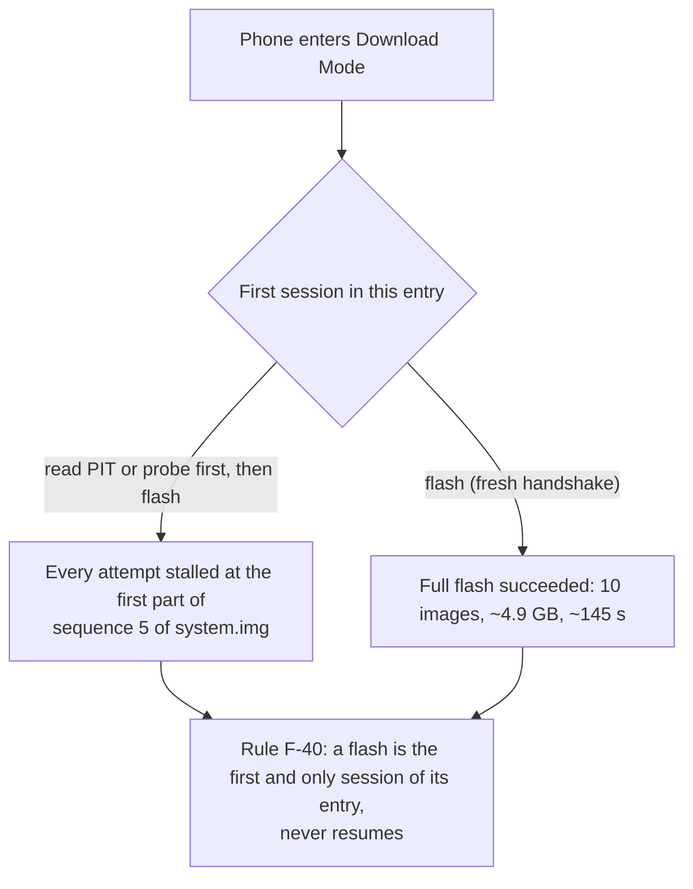
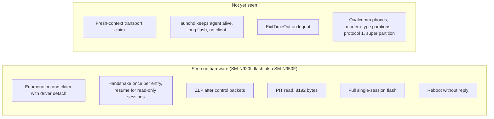

# Hardware verification

What has actually been observed on real hardware. Anything not listed here is UNVERIFIED (requirement S-2 in [requirements.md](requirements.md)).

Phones tested: SM-N920I (Galaxy Note 5, Exynos 7420, UFS; the maintainer's dedicated test phone, firmware N920IDVU5CVG2, and the source of most results below), SM-N950F, and SM-N915G (tested by the owner; details not yet recorded here, so treat its results as UNVERIFIED until they are). The SM-N986U1 is currently in testing.

| What | Result |
|---|---|
| USB identity | `04e8:685d` in Download Mode, high speed. macOS binds `AppleUSBACMData` to the Odin interface, so it must be detached, which needs root. In Android the phone is `04e8:6860` with 2 configurations. |
| Handshake | Answered once per Download Mode entry. `resume` works for later read-only sessions. |
| Session | Begin ACK `0x30000` = protocol 3, so 1 MiB parts × 30; compressed transfer not advertised. Begin payload `0x7FFFFFFF` accepted. |
| ZLP after control packets | Required: without it, the third control packet of a session went unanswered. |
| PIT | 8192 bytes, `COM_TAR2` `LSI7420`, device type 8. Identifiers repeat across UFS units. No binary type 1 entries: the modem (RADIO) is type 0. Copy in `tests/fixtures/SM-N920I.pit`. The CSC's embedded `NOBLELTE_AUS_XSA.pit` gives an identical plan. |
| Full flash | Succeeded as a single fresh session: 10 images, about 4.9 GB, about 145 s. The phone restarted on the reboot request without replying. |
| Second session before flashing | Every flash that followed a separate PIT-read session in the same Download Mode entry stalled at the first part of sequence 5 of `system.img`. Hence F-40. |
| SM-N950F (Galaxy Note 8, Exynos 8895) | Full flash succeeded on 2026-11-09: about 6.6 GB in about 200 s, protocol 3. |
| SM-N986U1 (Galaxy Note 20 Ultra 5G), in testing; reports `SM8250` (`04e8:685d`) | **Does not work yet.** Since 2026-11-09 every probe, PIT read and flash stopped at the handshake with no data sent. Early attempts: the `ODIN` bulk write timed out. After the transport set the line coding and raised DTR (clear-halt, coding and DTR all succeeded), the write is accepted but the phone never answers `LOKE`. About 50 USB resets had hit that Download Mode entry, so a clean entry has not been tested. Cause unknown; suspects are the driver detach and re-attach resetting the phone before the handshake, and Qualcomm-bootloader differences. |
| Not yet seen on hardware | A claim through the fresh-context transport; launchd keeping the agent alive during a long flash with no client; `ExitTimeOut` on logout. |

## Why a flash must be the first session

## Coverage

