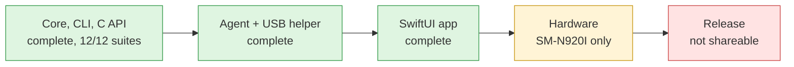
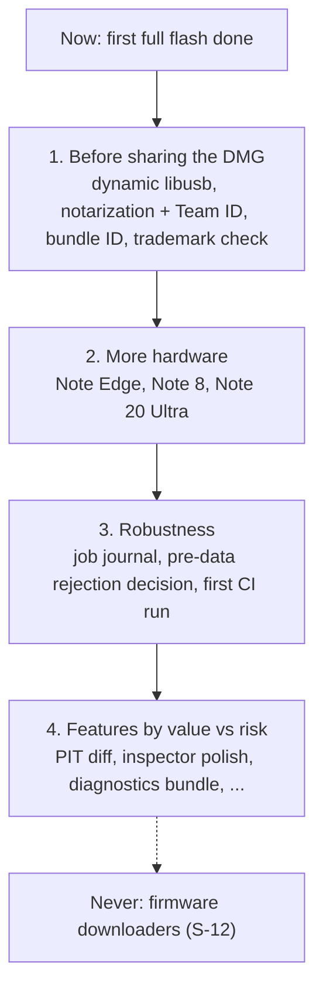

# Status and roadmap

State as of 2026-11-08. Requirement-level status is in [requirements.md](requirements.md); hardware results are in [hardware.md](hardware.md).

## Status

| Area | State |
|---|---|
| Core, CLI, C API | Complete; 12/12 test suites pass, no warnings |
| Background agent and root USB helper | Complete; registered and working with ad-hoc signatures |
| SwiftUI app | Complete; used for the first full flash |
| Hardware | **SM-N920I (Galaxy Note 5): full flash succeeded on 2026-11-08** (BL + AP + CP + full CSC, about 4.9 GB, about 2.5 min; the owner confirmed it worked). Nothing else has been tested on hardware. |
| Release | DMG builds. **Not shareable yet:** no notarization (D-2) and libusb is linked statically (D-3). |

## Known issues

- **Late ZLP:** a zero-length IN packet arriving after the 100 ms drain window makes the next exchange read 0 bytes. This fails safely as a protocol violation, but mid-flash.
- **Model typed as `SMSM-…`:** `normalizeModel` strips only one `SM`, so the model never matches and is refused. This is fail-safe.
- **Agent crash:** if the agent crashes mid-flash, the job's state is lost (R-4).
- **Peer checks can be spoofed** until a Team ID exists (SEC-4/5).
- **libusb is linked statically** (D-3); **not notarized** (D-2); **bundle ID** is a placeholder (D-5); **trademark check** not done (D-6).
- **Flashing without a CSC:** a set with no embedded PIT (for example AP only) needs a PIT file. Taking a PIT Backup uses up the session, so the phone must then be restarted into Download Mode before flashing.
- **Newer phones** may use Download Mode product IDs not yet listed; they show as "not in Download Mode", which is fail-safe.
- **Not yet done:** a diagnostics bundle (History export only), String Catalogs, a check of the Xcode-generator build path, and a first CI run.

## Roadmap

1. **Before sharing the DMG:** a dynamic libusb (D-3), a Developer ID with notarization and a Team ID (D-2, SEC-5), a real bundle ID (D-5), the trademark check (D-6).
2. **More hardware:** Note Edge, Note 8 and Note 20 Ultra (`super`, newer protocol); record their PITs as fixtures.
3. **Robustness:** a persisted job journal (R-4); a decision on closing after a pre-data rejection; a first CI run.
4. **Features, ranked by value against risk:**
   1. PIT diff (device vs firmware)
   2. Package inspector polish
   3. Diagnostics bundle
   4. Download Mode guidance
   5. Single-partition presets
   6. Bootloader rollback check
   7. Optional ADB "reboot to Download Mode"
   8. A/B and dynamic-partition awareness

   **No firmware downloaders** (S-12).

