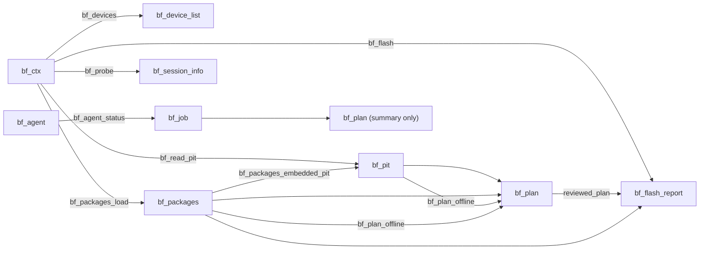
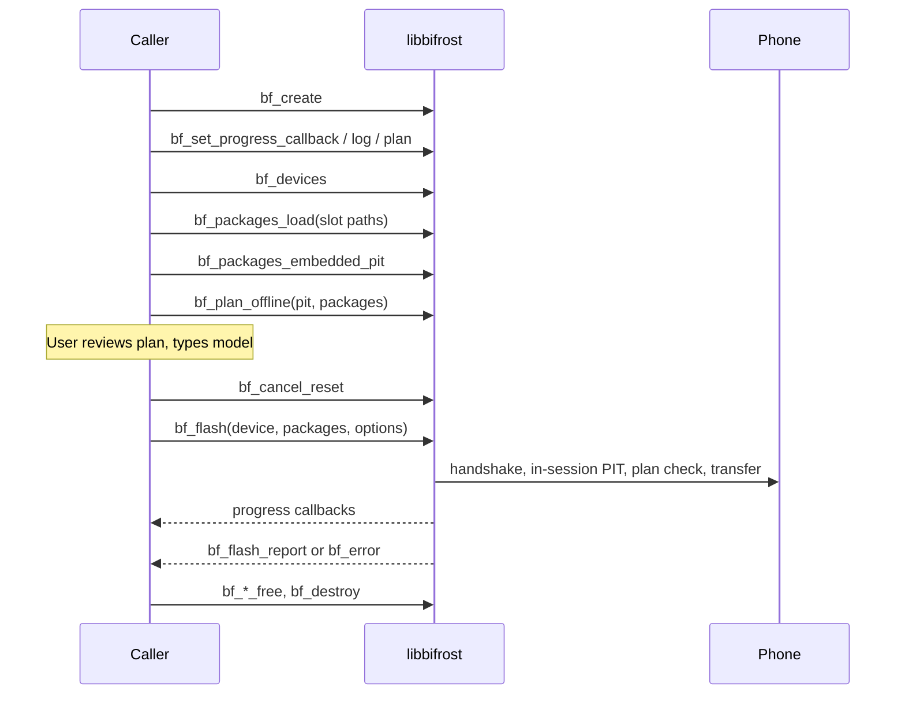
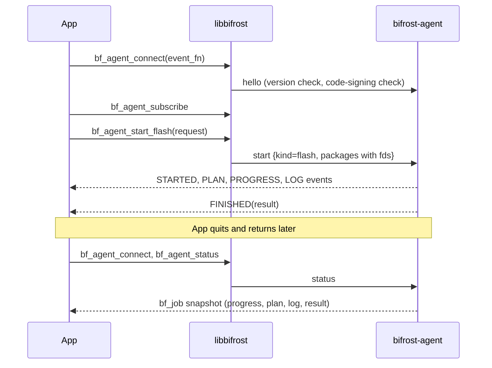
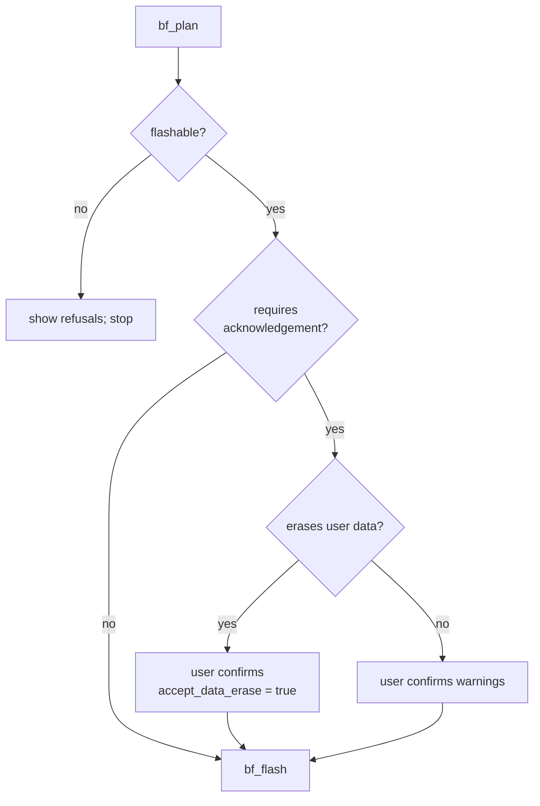
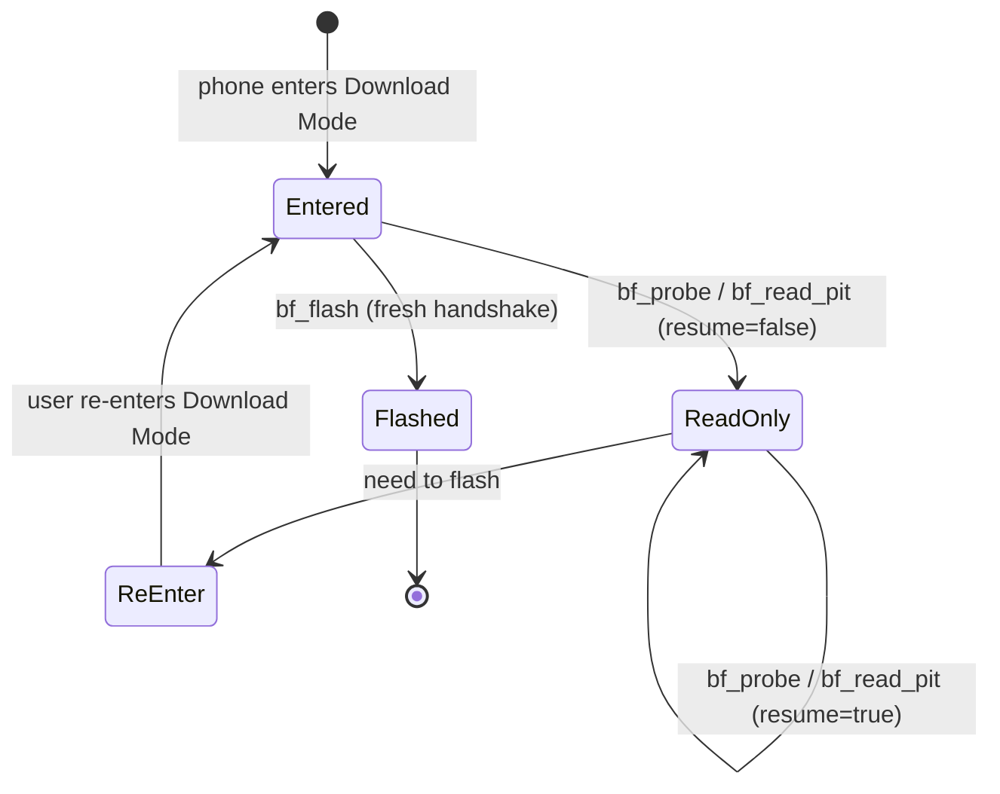
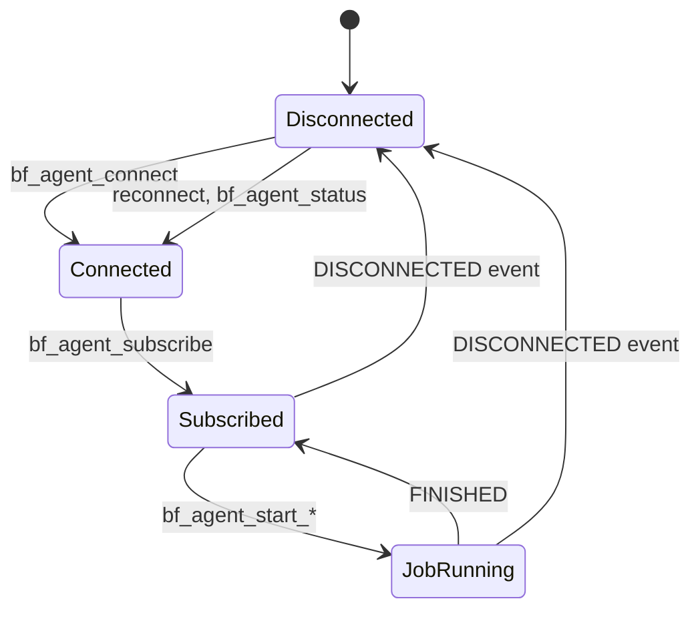

# C API reference

Header: `src/core/include/bifrost/bifrost.h`. `BF_API_VERSION` is 1 (bumped on any incompatible change). C99-clean. Only `bf_*` symbols are exported; `tests/check_exports.sh` enforces this.

## Conventions

- Anything that can fail takes a `bf_error*` (may be NULL) and returns NULL or false. On success the error is cleared.
- Objects from `create`/`load`/`read`/`plan` functions belong to the caller; release them with the matching `*_free` (or `bf_destroy`).
- Strings from accessors are **borrowed** until the owning object is freed.
- Long operations block the calling thread and call the context's callbacks on that thread. **One long operation per context at a time**; a second fails with `BF_E_ILLEGAL_STATE`.
- All sizes are `uint64_t`.

## Object model

| Handle | Created by | Freed by |
|---|---|---|
| `bf_ctx` | `bf_create` | `bf_destroy` |
| `bf_device_list` | `bf_devices`, `bf_agent_devices` | `bf_device_list_free` |
| `bf_packages` | `bf_packages_load` | `bf_packages_free` |
| `bf_pit` | `bf_pit_parse`, `bf_pit_load_file`, `bf_packages_embedded_pit`, `bf_read_pit` | `bf_pit_free` |
| `bf_plan` | `bf_plan_offline` | `bf_plan_free` |
| `bf_agent` (macOS) | `bf_agent_connect` | `bf_agent_free` |
| `bf_job` (macOS) | `bf_agent_status` | `bf_job_free` |

## Typical call sequences

### In-process (needs root for USB)

### Through the agent (what the app does)

## Errors

`bf_error { int32 code; int32 data_state; int32 native_code; char message[1024] }`. Decide recovery from `code` and `data_state`, never from `message`.

| Value | Constant | Name (`bf_code_name`) | Meaning |
|---|---|---|---|
| 0 | `BF_OK` | ok | Success |
| 1 | `BF_E_INVALID_ARGUMENT` | invalid-argument | Bad parameter |
| 2 | `BF_E_IO` | io | Local file or I/O error |
| 3 | `BF_E_PACKAGE_INVALID` | package-invalid | Not a usable firmware package |
| 4 | `BF_E_CHECKSUM_MISMATCH` | checksum-mismatch | MD5 trailer does not match |
| 5 | `BF_E_ARCHIVE_UNSUPPORTED` | archive-unsupported | TAR variant not supported |
| 6 | `BF_E_LZ4_INVALID` | lz4-invalid | LZ4 image failed to decode |
| 7 | `BF_E_INSUFFICIENT_SPACE` | insufficient-space | Not enough disk space |
| 8 | `BF_E_FILE_CHANGED` | file-changed | Package changed after verification |
| 9 | `BF_E_PIT_INVALID` | pit-invalid | PIT missing, ambiguous or malformed |
| 10 | `BF_E_PLAN_REFUSED` | plan-refused | Planner refused (rules: [../design/protocol.md](../design/protocol.md#planner-rules)) |
| 11 | `BF_E_MODEL_MISMATCH` | model-mismatch | Typed model does not match |
| 12 | `BF_E_USB_DISCONNECTED` | usb-disconnected | Device went away |
| 13 | `BF_E_USB_TIMEOUT` | usb-timeout | Transfer timed out |
| 14 | `BF_E_USB_STALL` | usb-stall | Endpoint stalled |
| 15 | `BF_E_USB_ACCESS` | usb-access | Could not open or claim (permissions, driver) |
| 16 | `BF_E_USB_OTHER` | usb-other | Other libusb failure (`native_code`) |
| 17 | `BF_E_PROTOCOL_VIOLATION` | protocol-violation | Unexpected reply |
| 18 | `BF_E_BOOTLOADER_REJECTED` | bootloader-rejected | Negative status from the phone |
| 19 | `BF_E_CANCELLED` | cancelled | Stopped by `bf_cancel` |
| 20 | `BF_E_ILLEGAL_STATE` | illegal-state | e.g. second concurrent operation |
| 21 | `BF_E_SERVICE_UNAVAILABLE` | service-unavailable | Agent or USB helper unreachable |
| 100 | `BF_E_UNSUPPORTED` | unsupported | e.g. built without USB support |

Descriptions marked by meaning rather than quoted text are inferred from the code names; see `src/core/src/common/error.cpp` for exact strings.

| `data_state` | Constant | Recovery implication |
|---|---|---|
| 0 | `BF_DATA_NONE` | Nothing was sent; the phone is unchanged |
| 1 | `BF_DATA_PARTIAL` | Some partition data may be written; treat the phone as needing a full re-flash |
| 2 | `BF_DATA_COMPLETE` | All data acknowledged; only close or reboot failed |

## Function reference

### Version and names

| Function | Notes |
|---|---|
| `uint32_t bf_api_version(void)` | Returns `BF_API_VERSION` |
| `const char* bf_version(void)` | Library version string |
| `const char* bf_code_name(int32_t)` | Stable kebab-case, for logs and localisation keys |
| `const char* bf_data_state_name(int32_t)` | `none` / `partial` / `complete` |

### Context and callbacks

| Function | Notes |
|---|---|
| `bf_create(err)` / `bf_destroy(ctx)` | libusb transport |
| `bf_set_log_callback(ctx, fn, user)` | `fn(user, level, message)`; levels `BF_LOG_INFO/WARNING/ERROR` |
| `bf_set_progress_callback(ctx, fn, user)` | `fn(user, const bf_progress*)` |
| `bf_set_plan_callback(ctx, fn, user)` | Plan built inside the flash session, before data; borrowed for the callback only |
| `bf_cancel(ctx, level)` | Any thread. `BF_CANCEL_BEFORE_DATA` (1), `BF_CANCEL_AFTER_SEQUENCE` (2) |
| `bf_cancel_reset(ctx)` | Required before a new operation |

`bf_progress` fields: `phase`, `slot`, `entry`, `file_done`, `file_total`, `total_done`, `total`.

`COMMITTING` means the phone is writing a sequence and may take a while; it repeats after each sequence.

### Devices and hot-plug

| Function | Notes |
|---|---|
| `bf_devices(ctx, err)` | Returns `bf_device_list` |
| `bf_device_list_count / _get(list, i, &info)` | `bf_device_info`: id (vendor, product, bus, address), `has_odin_interface`, interface, alternate, endpoints |
| `bf_device_list_warning_count / _warning` | Enumeration warnings |
| `bf_start_hotplug(ctx, fn, user)` | Callback on an internal thread; false if unsupported; replaces any earlier one |
| `bf_stop_hotplug(ctx)` | |

USB addresses change on every re-enumeration. Enumerate right before use.

### Packages

| Function | Notes |
|---|---|
| `bf_packages_load(ctx, paths, count, err)` | Verifies MD5, parses TAR; no device access; reports `VERIFYING`; honours cancel |
| `bf_packages_count / _get` | `bf_package_info`: slot, path, archive size, checksum present/valid/hex, entry count, kind, build, model, CSC code, bootloader revision (-1 unknown) |
| `bf_packages_entry(pk, pi, ei, &info)` | `bf_entry_info`: name, stored size, `lz4` |
| `bf_packages_free` | |

Slots: `BF_SLOT_BL`=0, `AP`=1, `CP`=2, `CSC`=3, `USERDATA`=4. Kinds (from the file name only, a heuristic): UNKNOWN, BL, AP, CP, CSC (full, may erase user data), HOME_CSC, USERDATA.

### PIT

| Function | Notes |
|---|---|
| `bf_pit_parse(bytes, size, err)` / `bf_pit_load_file(path, err)` | |
| `bf_packages_embedded_pit(pk, err)` | The root-level `*.pit` in the packages; `BF_E_PIT_INVALID` if none, several, or unparsable. Lets a plan be reviewed without opening a session |
| `bf_read_pit(ctx, device, resume, err)` | One read-only session. `resume` skips the handshake (see below) |
| `bf_pit_bytes(pit, &size)` | Raw bytes |
| `bf_pit_entry_count / _get` | `bf_pit_entry`: binary type (0 AP, 1 CP), device type, identifier, attributes, sizes, partition name, flash and FOTA file names |
| `bf_pit_free` | |

### Plans

| Function | Notes |
|---|---|
| `bf_plan_offline(pit, packages, err)` | No device access |
| `bf_plan_flashable` | False when there are refusals |
| `bf_plan_requires_acknowledgement` | Full CSC, USERDATA slot or data partition |
| `bf_plan_erases_user_data` | Pair with `accept_data_erase` |
| `bf_plan_detected_model`, `bf_plan_bootloader_revision` | `""` / -1 when unknown |
| `bf_plan_file_count / bf_plan_file` | `bf_planned_file`: slot, entry, partition, partition id, stored size, lz4 |
| `bf_plan_skipped_count / bf_plan_skipped` | Entries skipped, with a reason |
| `bf_plan_warning_count / bf_plan_warning(plan, i, &requires_ack)` | |
| `bf_plan_refusal_count / bf_plan_refusal` | Any refusal makes the plan unflashable |
| `bf_plan_free` | |

### Sessions

| Function | Notes |
|---|---|
| `bf_probe(ctx, device, resume, &info, err)` | Handshake (unless `resume`), begin, end. No PIT or file data |
| `bf_flash(ctx, device, packages, &options, &report, err)` | Exactly one session with a fresh handshake; `report` may be NULL |

`bf_flash_options`: `typed_model` (required), `accept_data_erase`, `reboot`, `reviewed_plan` (optional; in-session plan must match). There is deliberately **no `resume`**.

`bf_session_info`: raw `session_ack`, `protocol_version`, `supports_compressed_transfer`, `packet_size`, `parts_per_sequence`. `bf_flash_report`: session info, `bytes_transferred`, `rebooted`.

#### Resume and session order

The bootloader answers the handshake once per Download Mode entry. A probe or PIT read may therefore be followed by another read-only session with `resume = true`, but a flash must start from a fresh entry.

### Background agent (macOS only)

Events arrive on an internal queue. No callback starts after `bf_agent_free` returns, and pointers inside an event are valid only during the callback.

| Function | Notes |
|---|---|
| `bf_agent_connect(fn, user, err)` | Connects and checks the agent's code signature |
| `bf_agent_subscribe` | Starts events and hot-plug notifications |
| `bf_agent_devices` | `bf_device_list` |
| `bf_agent_start_flash(agent, &request, &job, err)` | `bf_agent_flash_request`: device, packages (opened here, descriptors passed on), typed model, `accept_data_erase`, `reboot`, optional `reviewed_pit` bytes |
| `bf_agent_start_probe / _start_read_pit(agent, device, resume, &job, err)` | |
| `bf_agent_cancel(agent, level, err)` | |
| `bf_agent_status(agent, err)` | Returns a `bf_job`, or NULL with `error.code == BF_OK` if no job has run |
| `bf_job_id/kind_of/running/device/progress/plan/log_count/log/result_get/free` | Snapshot accessors; `bf_job_result_get` is false while running |

Event kinds: `STARTED` 0, `PROGRESS` 1, `LOG` 2, `PLAN` 3, `FINISHED` 4, `DEVICES_CHANGED` 5, `DISCONNECTED` 6 (agent went away; reconnect). A plan delivered by event or by `bf_job_plan` is a **summary only** and cannot be used as `reviewed_plan`; pass `reviewed_pit` instead.

## Thread-safety summary

| Call | Thread |
|---|---|
| `bf_cancel` | Any thread |
| Log, progress and plan callbacks | The thread running the operation |
| Hot-plug callback | Internal thread |
| Agent event callback | Internal queue |
| Everything else | One long operation per context at a time |
