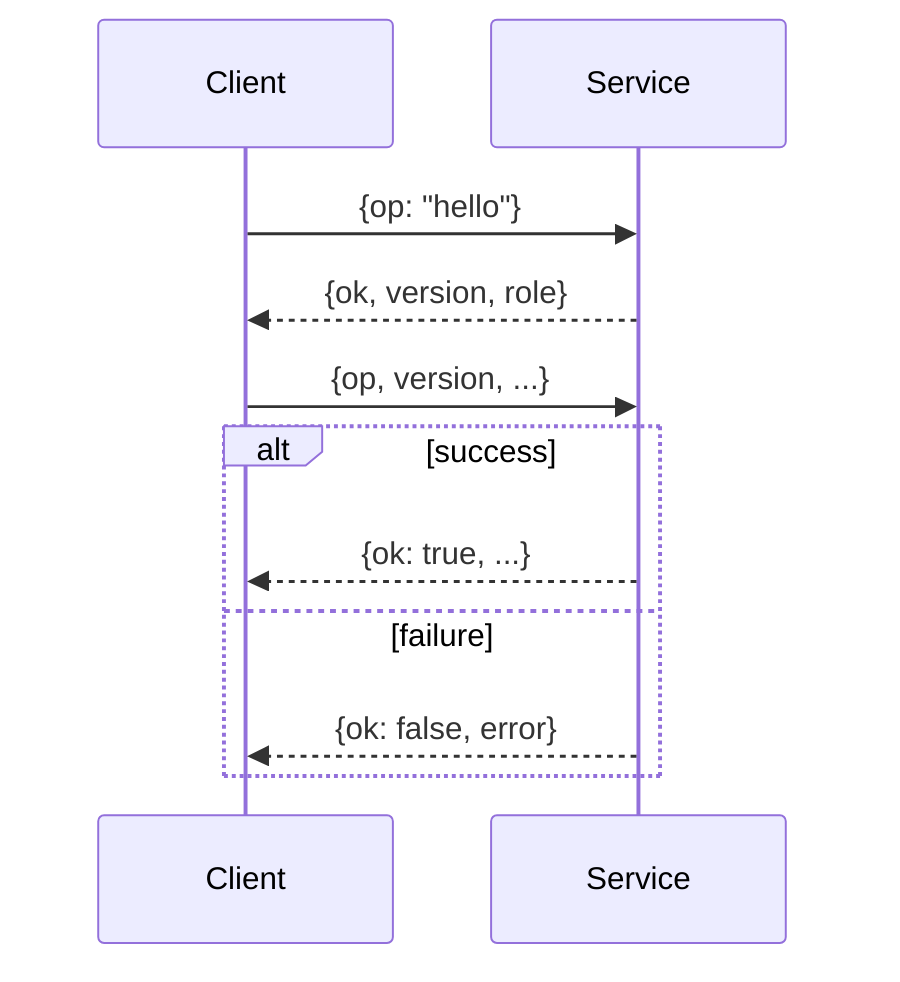
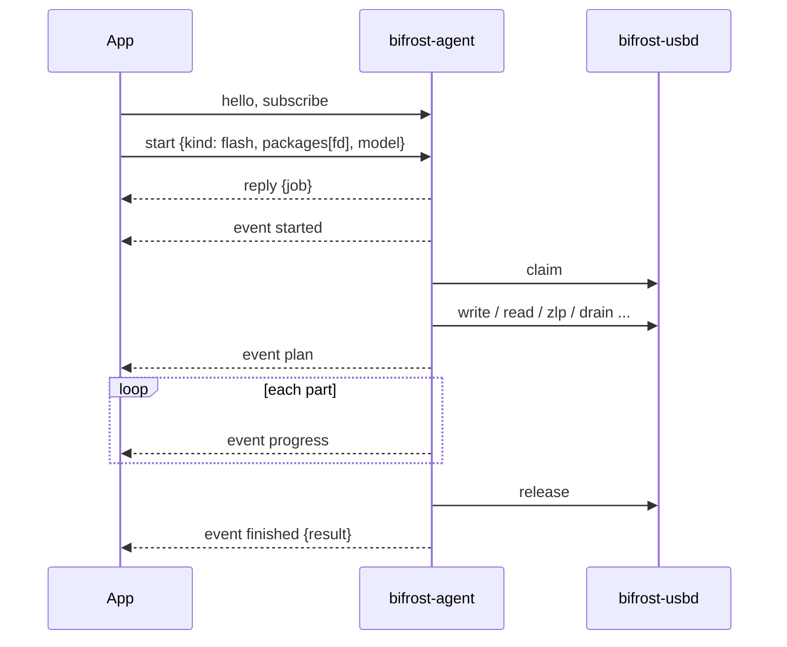
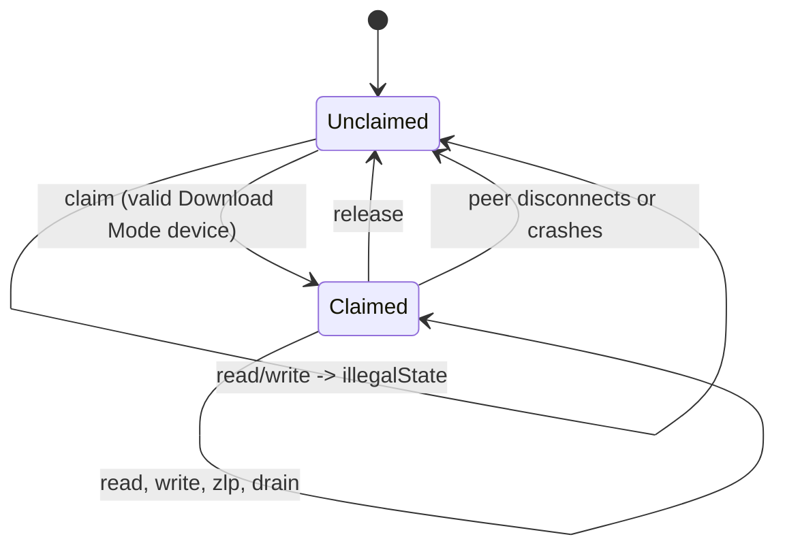
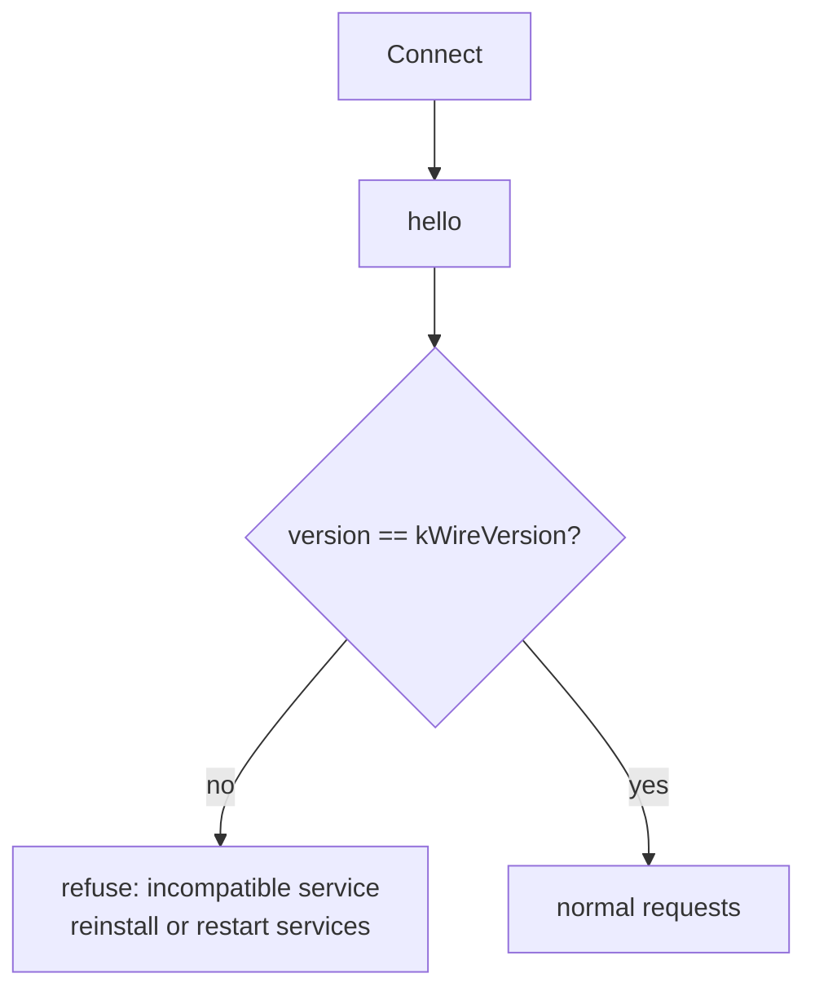

# Service wire protocol (XPC)

Sources: `src/service/include/bifrost/service/wire.hpp`, `agent.hpp`, `usb_service.hpp`; handlers in `src/service/src/agent.cpp` and `usb_service.cpp`.

## Conventions

- Every request is an XPC dictionary with `op` (string). After `hello`, requests also carry `version`.
- Every reply carries `ok` (bool). A failed reply carries `error`, an encoded `bifrost::Error` (code, message, data state, native code).
- Events have `event` (string) and no reply.
- **`kWireVersion` is 1.** Peers must match exactly; a different `version` is refused.
- Peers are authenticated with `xpc_connection_set_peer_code_signing_requirement`. Without `-DBIFROST_TEAM_ID` it matches the signing identifier only ([../design/services.md](../design/services.md), SEC-4/SEC-5).
- XPC failures map to `serviceUnavailable` (connection interrupted or invalid) or a requirement error (peer failed its signing check).

## bifrost-agent (role `agent`)

One job at a time. Firmware arrives as file descriptors.

| `op` | Request keys | Reply keys | Notes |
|---|---|---|---|
| `hello` | none | `version`, `role="agent"` | |
| `devices` | `version` | `enumeration` | Samsung devices and warnings |
| `status` | `version` | `job` (snapshot), absent if no job has run | Reattach after a reconnect |
| `subscribe` | `version` | none beyond `ok` | Start events on this connection, and `devices-changed` |
| `start` | `version`, `kind`, device identity, `resume`, kind-specific keys | `job` (id) | `illegalState` if a job is running |
| `cancel` | `version`, `level` | none beyond `ok` | 1 before-data, 2 after-sequence |

`start` keys by kind:

| `kind` | Extra keys | Rules |
|---|---|---|
| `flash` | `packages` array of `{slot, name, fd}`, `model` (required), `acceptErase`, `reboot`, optional `reviewedPit` (data) | `resume` is **refused**: a flash must be the first session of a Download Mode entry |
| `probe` | none | `resume` allowed |
| `readPit` | none | `resume` allowed; the PIT comes back in the result |

The device's vendor ID must be Samsung (0x04E8).

### Events

| `event` | Extra keys | Meaning |
|---|---|---|
| `started` | `job`, `kind` | Job accepted |
| `progress` | `job`, `progress` | Throttled to ~50 ms |
| `log` | `job`, `level`, `message` | Also kept in the snapshot (last 500 lines) |
| `plan` | `job`, `plan` | Plan built in-session, before data. Summary only |
| `finished` | `job`, `result` | Success or error, session info, bytes, rebooted, PIT for read-pit |
| `devices-changed` | `job`=0 | Hot-plug |

## bifrost-usbd (role `usbd`)

Each peer connection holds at most one claimed interface, released when the peer disconnects or crashes.

| `op` | Request keys | Reply keys | Notes |
|---|---|---|---|
| `hello` | none | `version`, `role="usbd"` | |
| `enumerate` | `version` | `enumeration` | |
| `claim` | `version`, device identity | interface selection | Samsung vendor + Download Mode product IDs only; `illegalState` if already claimed |
| `watch` | `version` | `supported` | Subscribes to hot-plug; event `devices-changed` |
| `release` | `version` | none beyond `ok` | |
| `write` | `version`, `data`, `timeout` | `count` | Bulk OUT |
| `read` | `version`, `size`, `timeout` | `data` | Bulk IN |
| `zlp` | `version`, `timeout` | none beyond `ok` | Zero-length OUT, best effort |
| `drain` | `version`, `timeout` | none beyond `ok` | Optional zero-length IN read |

Limits enforced on every request:

| Limit | Value | Constant |
|---|---|---|
| Transfer size | ≤ 2 MiB | `kMaximumTransfer` |
| Timeout | 1 to 600 000 ms; 0 or larger is rejected | `kMaximumTimeoutMs` |
| Claims per connection | 1 | |
| Vendor | 0x04E8 only | `kSamsungVendorId` |

The helper never opens files, parses firmware or interprets Odin.

## Encoded types

| Type | Keys (as seen in `wire.cpp`) |
|---|---|
| Identity | `vid`, `pid`, `bus`, `address` |
| Interface selection | interface, alternate, endpoints (see `putSelection`) |
| Session info | `ack`, version, compressed support, packet size, parts per sequence (`odin`) |
| Progress | phase, `slot`, `entry`, file and total counters |
| Plan summary | `flashable`, `requiresAck`, `erasesUserData`, `model`, `blRevision`, files (`slot`, `entry`, `partition`, `size`, `compressed`), skipped (`reason`), `warnings`, `refusals` |
| Error | code, `message`, `native`, data state |
| Result | error?, session, bytes, `rebooted`, `pit` |
| Snapshot | id, `kind`, `running`, device, progress, plan?, log, result? |

Key names for the nested session, progress and error encodings are only partly confirmed from a grep of `wire.cpp`; read `wire.cpp` for the exact spelling before writing a new client.

## Client compatibility

Any incompatible change to the encoding must bump `kWireVersion`. The app, CLI, agent and helper ship together, so a mismatch normally means a stale launchd job after an upgrade (restart both services; see [../guides/build-and-install.md](../guides/build-and-install.md)).
