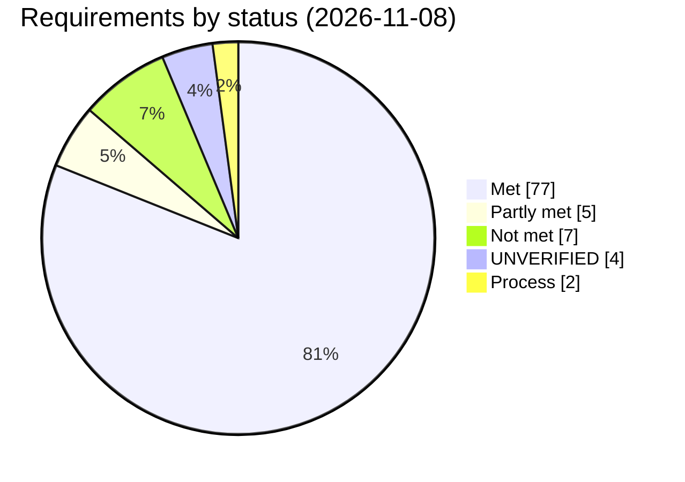

# Requirements

Every requirement, with its status on 2026-11-08 (hardware scope in P-3 and P-4, and F-83 and F-84, added 2026-11-10). IDs are stable, so code comments and issues cite them (for example F-40, S-4).

**Status values**
- **Met**: implemented and covered by tests, or observed on hardware.
- **Partly met**: some of it is in place; the note says what is missing.
- **Not met**: not implemented yet.
- **UNVERIFIED**: implemented, but not shown to work on real hardware or a real system.
- **Process**: a working rule, not a feature (S-2, E-7).

## Status at a glance

95 requirements (counted from the tables below; "Met in tests; UNVERIFIED under launchd" counts as UNVERIFIED).

Open items, by area:

| Area | Open requirements |
|---|---|
| Scope | P-3, P-4 (SM-N915G, SM-N920I and SM-N950F tested; SM-N986U1 in testing) |
| Devices | F-3 (hot-plug path untested end to end) |
| Background | F-80, F-82 (UNVERIFIED under launchd) |
| Android tools | F-83, F-84 (UNVERIFIED on hardware) |
| Security | SEC-4, SEC-5 (no Team ID) |
| Reliability | R-4 (no persisted job journal) |
| UX | UX-6 (String Catalogs) |
| Distribution | D-2, D-3, D-5, D-6 (not shareable yet) |
| Engineering | E-4 (CI never run) |

Before sharing the DMG: D-2, D-3, D-5, D-6, SEC-5. Hardening: R-4, E-4, F-80, F-82. Coverage: P-3, P-4, F-3, UX-6.

## Product and scope

| ID | Requirement | Status |
|---|---|---|
| P-1 | The product is named **Bifrost Studio** (working name "Gungnir"). | Met |
| P-2 | Target: macOS 13 or newer, as one universal binary (arm64 + x86_64). | Met (built and run on Intel only) |
| P-3 | Works with phones that Odin and Loke can flash, i.e. Samsung phones in Download Mode. | Partly met: tested on the SM-N915G, SM-N920I and SM-N950F; SM-N986U1 in testing |
| P-4 | Supports every Samsung device and region. The model is detected automatically: from the firmware file names, and by checking the CSC's embedded PIT against the phone's PIT. | Partly met: implemented; tested on the SM-N915G, SM-N920I and SM-N950F; SM-N986U1 in testing |
| P-5 | Parts: a C++17 core with a stable C API, a command-line tool, a SwiftUI app, a background agent and a root USB helper. | Met |
| P-6 | Distributed as a DMG only. No Homebrew. | Met (DMG is ad-hoc signed; see D-2) |

## Functional requirements

### Devices

| ID | Requirement | Status |
|---|---|---|
| F-1 | List connected Samsung USB devices (vendor ID `0x04E8`) and show for each whether it is in Download Mode. | Met |
| F-2 | Treat a device as in Download Mode only if its product ID is `0x6601`, `0x685D` or `0x68C3` (Heimdall's list) **and** it has a CDC Data interface with one bulk IN and one bulk OUT endpoint. A phone running Android must never be offered as a target. | Met (`0x685D` seen on hardware) |
| F-3 | Notice devices being plugged in and removed (hot-plug) and refresh the list. Never enumerate devices while a job is running. | Partly met: the full path from transport to app is untested |
| F-4 | Pick the phone automatically when exactly one is in Download Mode. | Met |
| F-5 | Always enumerate against a fresh libusb context, so the USB addresses shown are current. | Met (2026-11-08) |

### Firmware

| ID | Requirement | Status |
|---|---|---|
| F-10 | Accept five slots: BL, AP, CP, CSC (or HOME_CSC) and USERDATA. Each takes a `.tar.md5` or `.tar` file. | Met |
| F-11 | Check the MD5 of every `.tar.md5` before use. Show plain `.tar` files as having no checksum. | Met |
| F-12 | Parse TAR archives with GNU long names, PAX path/size headers and base-256 sizes. Support images of 8 GiB and larger. | Met (sizes ≥ 8 GiB are covered by tests, not hardware) |
| F-13 | Decode every LZ4 image once before touching the device. This rejects corrupt images before any data is sent and gives each image's exact size. | Met |
| F-14 | Refuse a firmware file that changed after it was checked (device, inode, size and modification time are compared). | Met |
| F-15 | Get the model code, build, CSC code and bootloader revision from the firmware file names. | Met |
| F-16 | Let the user choose CSC or HOME_CSC. A full CSC or a USERDATA image needs an explicit data-erase acknowledgement. | Met |

### Partition table (PIT) and planning

| ID | Requirement | Status |
|---|---|---|
| F-20 | Read the phone's PIT in a read-only session (Tools › PIT Backup, or `read-pit`). | Met (SM-N920I, 8192 bytes) |
| F-21 | Parse PITs, including identifiers and partition names repeated across UFS logical units (for example XBL in the SM-N986U1 firmware PIT). `compare()` pairs repeated names by occurrence; the planner refuses any image that matches more than one partition. | Met |
| F-22 | Map each archive entry to a partition. A PIT `flashFilename` must equal the entry name exactly, or the entry name minus `.lz4` (case-sensitive). | Met |
| F-23 | Skip `meta-data/*` and root-level `*.pit` entries, and say why. Refuse any other entry that doesn't map to a partition. | Met |
| F-24 | Always refuse: modem-type targets (PIT binary type 1), targets whose identifier is shared, images matching more than one partition (repeated PIT names are allowed), ambiguous matches, empty images, a package in the wrong slot by its file name, and packages for different models. | Met |
| F-25 | Refuse a firmware whose embedded PIT differs from the phone's PIT in layout or size, because re-partitioning is not supported. | Met |
| F-26 | Flash in this order: BL, AP, CP, CSC, USERDATA. | Met |
| F-27 | Let the user review the plan without opening a session on the phone, using the firmware's embedded PIT or a PIT file. | Met (2026-11-08) |

### Confirmation

| ID | Requirement | Status |
|---|---|---|
| F-30 | The app supplies the firmware's detected model, and the core checks it against the plan (the CLI still takes `--model`). If the firmware's model can't be detected, the user must acknowledge that separately. A flash that erases data needs a final "Erase and Flash" confirmation. | Met |
| F-31 | A plan that erases user data needs an explicit acknowledgement. | Met |
| F-32 | Every acknowledgement apply to one reviewed plan. They are cleared when the firmware changes, the PIT changes, a flash starts or the flow is reset. | Met |
| F-33 | The Flash button has no keyboard shortcut. | Met |

### Flashing

| ID | Requirement | Status |
|---|---|---|
| F-40 | A flash is **one** Odin session and the **first session of its Download Mode entry**: handshake, begin, part size, read the PIT, plan, announce the total, files, end. It never resumes. | Met (complete flash of SM-N920I, 2026-11-08) |
| F-41 | Inside the session, rebuild the plan from the phone's own PIT. Refuse before any data if it has refusals, differs from the reviewed plan, or the confirmation doesn't match. | Met |
| F-42 | Stream images in plan order, using the part size and parts-per-sequence the phone negotiated. | Met |
| F-43 | Report progress per acknowledged part, including a "committing" phase while the phone writes each sequence. | Met |
| F-44 | Optionally reboot at the end. If the phone disconnects right after the reboot request instead of replying, report success with a warning. | Met (SM-N920I restarts without replying) |
| F-45 | Every error has a code and a data state (none, partial or complete), so the recovery advice is accurate. | Met |
| F-46 | A failure inside a transfer names the stage, the sequence and the bytes acknowledged. A failed job still reports the session and the bytes acknowledged. | Met |

### Cancellation

| ID | Requirement | Status |
|---|---|---|
| F-50 | **Cancel before data**: always safe; nothing is written. | Met |
| F-51 | **Stop after the current sequence**: only behind an explicit partial-write warning. | Met |
| F-52 | A cancel request stays in effect until it is reset, so a stale cancel stops the next operation before any data is sent. | Met (C API) |

### Read-only tools

| ID | Requirement | Status |
|---|---|---|
| F-60 | Probe: handshake, begin, end. No PIT read and no file data. | Met (SM-N920I) |
| F-61 | PIT Backup to a file the user chooses. | Met |
| F-62 | Inspect: list firmware entries, show a PIT table, build an offline plan. | Met |
| F-63 | Probe and PIT Backup can resume a session in the same Download Mode entry, because the phone answers the handshake once per entry. | Met (SM-N920I) |

### History

| ID | Requirement | Status |
|---|---|---|
| F-70 | Keep a record of every job: phone, files, result, session, bytes, duration and log (at most 2000 lines). | Met |
| F-71 | Filter, search, delete, export (text, JSON, bug report), and retry with the same files after a new review and confirmation. | Met |
| F-72 | Retention is configurable; the default keeps the last 200 jobs. | Met |

### Background operation

| ID | Requirement | Status |
|---|---|---|
| F-80 | A flash keeps running if the app window closes or the app quits. When the app reopens, it reattaches to the running job. | Met in tests; UNVERIFIED under launchd during a long flash |
| F-81 | Only one job runs at a time. Clients can reattach (status snapshot plus the last 500 log lines) and subscribe to live events. | Met |
| F-82 | On logout or unregistering, the agent asks a running flash to stop at the next safe point, within launchd's `ExitTimeOut` of 300 s. | UNVERIFIED |

### Android tools

| ID | Requirement | Status |
|---|---|---|
| F-83 | Bundled Android platform-tools: reboot a phone to Download Mode or Recovery with `adb` from the app's Tools. | UNVERIFIED |
| F-84 | TWRP preparation: load a chosen TWRP `.img.tar` as the only AP file with automatic restart off. It never unlocks a bootloader. | UNVERIFIED |

## Safety requirements

These come first and override convenience.

| ID | Requirement | Status |
|---|---|---|
| S-1 | **Fail safe:** refuse on any ambiguity. | Met (enforced by the planner and the session) |
| S-2 | Never claim a device behaviour works without a test or a cited source. Mark anything else UNVERIFIED. | Process |
| S-3 | **No destructive features** (re-partitioning, NAND erase, userdata erase) unless the maintainer approves a design. | Met (none exist) |
| S-4 | **Never send `0x64/1`.** Its meaning is disputed. | Met (the simulator fails any test that sends it) |
| S-5 | Refuse modem-type targets (PIT binary type 1) until hardware settles their end-of-sequence layout. | Met |
| S-6 | Treat any negative status from the bootloader as a failure. | Met |
| S-7 | Treat zero-length packets as best-effort: only a disconnect is fatal. | Met |
| S-8 | Never share the Odin interface with the macOS CDC driver. Detach it explicitly and refuse to claim if the detach fails. | Met (hardware: the leak fixed and confirmed) |
| S-9 | Refuse to claim a device that isn't in Download Mode (product ID check in enumeration, in claim and in the root helper). | Met |
| S-10 | A wrong guess about whether the phone has already handshaken must fail before any data is sent. | Met |
| S-11 | Don't copy code from odin4 (Apache-2.0) or Thor (MPL-2.0). They may only be used as behavioural references. | Met |
| S-12 | Don't build firmware downloaders (legal and terms-of-service risk). | Met |

## Privileges and security

| ID | Requirement | Status |
|---|---|---|
| SEC-1 | The app is unsandboxed. USB access goes through a root helper registered with `SMAppService` and limited to USB claim and transfer. | Met |
| SEC-2 | The root helper accepts only Samsung devices and one claim per connection. Transfers are at most 2 MiB and timeouts at most 600 s. It checks the wire version on every request, opens no files and doesn't parse firmware. | Met |
| SEC-3 | The agent never opens files by path. The app or CLI passes it file descriptors, so no folder permissions are needed and no path can be swapped. | Met |
| SEC-4 | Every XPC connection checks its peer's code signature. The helper accepts only the agent; the agent accepts only the app and the CLI. | Partly met: identifier-only without a Team ID, so it can be spoofed (see D-2) |
| SEC-5 | Never ship without a Developer ID Team ID (`-DBIFROST_TEAM_ID`). | Not met (no Apple Developer account) |

## Reliability and performance

| ID | Requirement | Status |
|---|---|---|
| R-1 | Timeouts: handshake 3 s, control packet 10 s, data part 120 s, sequence commit 120 s, zero-length packet 100 ms. | Met |
| R-2 | The USB helper must not crash on devices that are re-enumerating or leaving. | Met (2026-11-08) |
| R-3 | If a client disconnects, the job keeps running. A helper that dies mid-flash surfaces as `usbDisconnected`, with the correct data state. | Met (tests) |
| R-4 | If the agent itself crashes, job state survives (a persisted journal). | Not met |
| R-5 | Throughput: a full SM-N920I firmware (about 4.9 GB) flashes in about 2.5 minutes. | Met (observed) |

## User experience

| ID | Requirement | Status |
|---|---|---|
| UX-1 | The flash flow has three steps: ① Setup (phone and firmware) ② Review & Confirm ③ Flash. | Met |
| UX-2 | Firmware is checked automatically 0.8 s after the last change; a newer set of files supersedes an older check. | Met |
| UX-3 | Results use a recovery card keyed on error code × data state. | Met |
| UX-4 | Flash is disabled while the phone has already been used in this Download Mode entry. The app explains how to restart it into Download Mode. | Met |
| UX-5 | The sidebar Devices section shows the phone state, and a banner appears when the background service is not connected. | Met |
| UX-6 | Localisable text (String Catalogs). | Not met (needs Xcode's toolchain) |
| UX-7 | Icon: the Asgard gate, a gold pointed arch with two door leaves filled with the Bifrost spectrum, on a dark indigo plate. No Samsung marks. | Met |

## Distribution and legal

| ID | Requirement | Status |
|---|---|---|
| D-1 | A DMG containing the app, an Applications link and a read-me (Gatekeeper, service registration, uninstall). | Met |
| D-2 | Developer ID signing and notarization. | Not met: there is no Apple Developer account, so the build is ad-hoc signed and Gatekeeper needs a manual override |
| D-3 | libusb (LGPL-2.1) is shipped as a replaceable dynamic library. | Not met: linked statically. **Must be fixed before sharing the DMG with anyone.** |
| D-4 | Third-party notices (LZ4 BSD-2, libusb LGPL-2.1) are bundled in the app. | Met |
| D-5 | A real bundle identifier replaces the `local.bifrost.test` placeholder. | Not met |
| D-6 | A trademark and name-conflict check for "Bifrost" (USPTO/EUIPO class 9, GitHub, App Store) before publishing. | Not met |
| D-7 | Not affiliated with Samsung; no Samsung marks. | Met |

## Engineering

| ID | Requirement | Status |
|---|---|---|
| E-1 | C++17 and Swift. No compiler warnings (`-Wall -Wextra -Wpedantic`). | Met |
| E-2 | Unit tests per layer, a stateful bootloader simulator with fault injection, and end-to-end tests over real XPC. | Met (12 suites) |
| E-3 | Fuzzing of the PIT, package, LZ4 and file-name parsers under ASan/UBSan. | Met locally (standalone driver); CI libFuzzer has never run |
| E-4 | CI: universal build, tests, and a fuzz job. | Partly met: written but never run on GitHub |
| E-5 | `libbifrost.dylib` exports only `bf_*` symbols, and its header compiles as C99. | Met (tested) |
| E-6 | Build directories live outside the repository. | Met |
| E-7 | Commit only when the maintainer asks. | Process |
