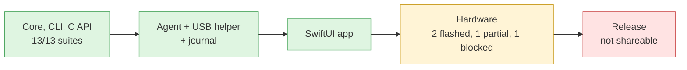

# Status and roadmap

Project health, known issues, and what is still blocked on hardware or release. Requirement IDs: [requirements.md](requirements.md). Observed device behaviour: [hardware.md](hardware.md).

**Last updated:** 2026-11-15 (docs merge: coverage content lives here).

## Status at a glance

| Area | State |
|---|---|
| Core, CLI, C API | Complete; **13/13** test suites pass, no warnings |
| Background agent and root USB helper | Complete; job journal (R-4); ad-hoc signing works |
| SwiftUI app | Complete; Flash, Inspect, History, Device, Android, Settings |
| Hardware | Full flashes on **SM-N920I** (2026-11-08) and **SM-N950F** (2026-11-09). **SM-N915G** tested (details not written up). **SM-N986U1** handshake still fails — [hardware.md](hardware.md). |
| Release | DMG + `release` target; bundled libusb dylib; scripts ready. **Notarized public build needs Developer ID (D-2).** |

## Known issues

- **Late ZLP:** fixed in the Odin session drain; covered by `test_sim_flash`.
- **Agent crash recovery:** journal survives agent death (R-4); USB session cannot resume (F-40); UI shows recovery snapshot — see [testing.md#reliability](testing.md#reliability).
- **Peer checks can be spoofed** until `BIFROST_TEAM_ID` (SEC-4/5).
- **Not notarized on a maintainer machine** (D-2): [release.md](release.md).
- **Trademark** (D-6): checklist in [release.md#trademark-d-6](release.md#trademark-d-6).
- **Flashing without a CSC:** AP-only needs a PIT file; PIT backup uses the session — restart into Download Mode before flash (F-40).
- **SM-N986U1:** no `LOKE` reply after handshake bytes; retries and COM-style USB setup UNVERIFIED — [hardware.md](hardware.md), [checklist below](#sm-n986u1-checklist-maintainer).
- **Unlisted Download Mode product IDs:** phone shows as "not in Download Mode" (fail-safe).
- **String Catalogs** (UX-6): `Localizable.xcstrings` in the app bundle; `en.lproj/Localizable.strings` kept for CMake/fallback; `scripts/check-l10n.sh` in CI.

## Coverage (code vs hardware)

Work that broadens Samsung support without needing every phone on the desk.

### Done in code

| Item | Where |
|------|--------|
| **F-3 hot-plug** | `test_service`: detach/attach → `devices-changed` |
| **Bootloader downgrade warning** | Planner + `test_planner` |
| **SUPER wire size** | 512-byte rounding + `test_sim_flash` |
| **Partial LOKE read** | `session.cpp` handshake accumulation |
| **Tools** | Device / Firmware / Android; standalone Inspect; `toolsPitDiff`; adb/fastboot; TWRP validation (UNVERIFIED on hardware) |
| **PIT fixtures** | `tests/fixtures/README.md` + `SM-N920I.pit` |

### Still hardware- or release-gated

| Item | Blocker |
|------|---------|
| **P-3 / P-4 "Met" on scope** | More models; **SM-N986U1** on clean Download Mode |
| **SM-N915G** | Record in [hardware.md](hardware.md) |
| **F-80 / F-82** | Long flash with agent under launchd after logout |
| **D-2 notarization** | Maintainer Apple ID |
| **New Download Mode PIDs** | Need a real device with an unlisted PID |

## SM-N986U1 checklist (maintainer)

1. Power off → enter Download Mode once (no prior probe in that entry).
2. Quit Smart Switch / other USB tools; direct cable.
3. Run **Probe** only after the sidebar shows Download Mode.
4. If handshake still fails: **Settings → Export Diagnostics Bundle**, note `spctl`/`log`, update [hardware.md](hardware.md).

Handshake retries and USB line setup: [protocol.md](protocol.md).

## Roadmap

Phases and Odin gaps: [roadmap.md](roadmap.md).

**Phase 0** (structure): sidebar split and welcome sheet are in the app; notarization and launchd checks remain maintainer tasks.

1. **Before sharing the DMG:** [release.md](release.md) (Developer ID + notarization, SEC-5) and trademark checklist (D-6).
2. **More hardware:** SM-N986U1; document SM-N915G; capture more PIT fixtures.
3. **Robustness:** close-after-pre-data rejection; F-80/F-82 — [testing.md#launchd-flash-resilience](testing.md#launchd-flash-resilience).
4. **Features (remaining):**
   - Bootloader rollback check (warning exists; policy TBD)
   - A/B and dynamic-partition awareness
   - **No firmware downloaders** (S-12)

Done recently: PIT diff (Review + Tools), diagnostics bundle, Download Mode guidance, AP-only preset, Tools overhaul, adb reboot paths (UNVERIFIED).