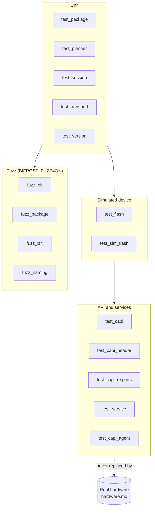
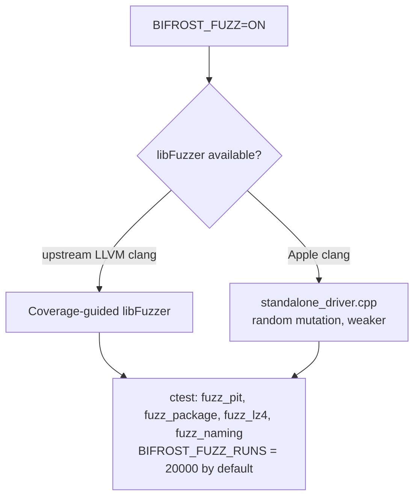

# Testing and tools

Build setup is in [build-and-install.md](build-and-install.md). Run everything with `ctest --test-dir <build> --output-on-failure`.

## Test layers



| Test | Covers |
|---|---|
| `test_package` | MD5 trailer, TAR parsing, naming |
| `test_planner` | Matching, refusals, warnings, `samePlan` |
| `test_session` | Odin session and packets |
| `test_transport` | Interface selection |
| `test_flash`, `test_sim_flash` | `flash::flash` against the simulator, including injected faults |
| `test_capi` | C API behaviour |
| `test_capi_header` | `bifrost.h` compiles as plain C |
| `test_capi_exports` | `check_exports.sh`: only `bf_*` symbols exported, and more than 40 of them |
| `test_service` | Agent and helper over XPC |
| `test_capi_agent` | The C agent client against a real agent (Apple only) |
| `fuzz_*` | Parsers must never crash or hang on hostile input |

The simulator is **not** evidence of real bootloader behaviour. It shows the host side is consistent and reacts safely to faults. Device behaviour counts as verified only after a hardware run, so keep [hardware.md](hardware.md) as the record.

## Bootloader simulator (`tests/support/sim_device.*`)

`sim::Device` implements `ClaimedInterface` and models an Odin bootloader from a PIT, then records what reached each partition (`PartitionWrite`: bytes, complete, binary type, device type, sequences).

### Fault injection (`sim::Faults`)

| Fault | Effect |
|---|---|
| `wrongAckAtPart`, `shortAckAtPart` | Bad or truncated data-part acknowledgement |
| `stallAtPart` | Endpoint stall |
| `disconnectAfterBytes` | Cable pulled after N data bytes |
| `negativeStatus {point, occurrence, status}` | Negative reply at `partSize`, `totalBytes`, `fileStart`, `sequenceStart`, `sequenceEnd`, `endSession` or `reboot` |
| `lateZlpAfterSequence` | A zero-length IN arrives late, so the next read sees 0 bytes |
| `commitDelayMs` | Slow sequence commit; a shorter read timeout times out |
| `zlpOutFailure` (+ `zlpFailureAfterData`) | Every zero-length OUT fails |
| `rejectBeginSession` | `BOOTLOADER_FAIL` on begin |
| `rebootDropsOff` | Phone leaves the bus on reboot; later transfers fail with the given code (SM-N920I showed `usbOther`) |
| `rebootSilent` | No reboot reply, stays attached |

Config also has `requireZlpAfterControl` (default on, models the SM-N920I), `advertiseCompression`, and an `onPart` hook to hold a transfer open (used for cancel tests).

## Simulator checks

Beyond recording writes, the simulator enforces protocol rules and fails a test when the host breaks one: phase order, sizes, padding, PIT fields, the announced total, one handshake per Download Mode entry, a zero-length packet after control packets (once the part size is set) and never `0x64/1` (S-4).

## Fuzzers

Configure with `-DBIFROST_FUZZ=ON` (single architecture, ASan + UBSan).



| Target | Input | Seeds (`tests/fuzz/corpus/`) |
|---|---|---|
| `fuzz_pit` | PIT bytes | empty, truncated, one, three, real SM-N920I, duplicate-name regression |
| `fuzz_package` | TAR / `.tar.md5` | simple, md5-trailer, md5-gate, pax-path, gnu-longname, base256, directory, traversal |
| `fuzz_lz4` | LZ4 frames | empty-frame, no-size, small-checked, multi-block, big-block |
| `fuzz_naming` | File names | `name0` to `name8` |

Notes:

- The committed seeds are read-only. Each target runs against a scratch work directory.
- `make_fuzz_corpus` regenerates the seeds.
- The standalone driver accepts `-runs=N`, `-max_total_time=S`, `-max_len=L`, `-seed=N`, and ignores other `-flags` so one command line works with both engines.
- A new crash input should be added to the corpus as a regression seed, as `regression-duplicate-name` was.

## Export check

`check_exports.sh` runs `nm -gU` on `libbifrost.dylib` and fails if any exported symbol does not start with `_bf_`, or if fewer than 40 `bf_` symbols are exported. The allowed export list is `src/core/src/capi/exports.txt`.

## Adding a test

1. Add `tests/test_<name>.cpp` and register it in `tests/CMakeLists.txt` (the loop at the top handles plain tests; `BIFROST_FIXTURES` points at `tests/fixtures`).
2. Use `tests/support/test_support.hpp` for helpers and `sim_device.hpp` when you need a phone.
3. For a protocol change, add a simulator fault case first, and keep the claim that it works UNVERIFIED until it runs on hardware.

## Running the fuzzers locally

Build prerequisites are in [build-and-install.md](build-and-install.md).

```sh
F=$HOME/Library/Caches/BifrostFuzz
cmake -S . -B $F -DCMAKE_BUILD_TYPE=RelWithDebInfo -DCMAKE_OSX_ARCHITECTURES=$(uname -m) \
    -DBIFROST_FUZZ=ON -DBIFROST_ENABLE_USB=OFF -DBIFROST_BUILD_APP=OFF
cmake --build $F -j8 && ctest --test-dir $F --output-on-failure
```

Apple clang has no libFuzzer runtime, so locally the targets use the weaker random-mutation driver. CI uses Homebrew LLVM.
